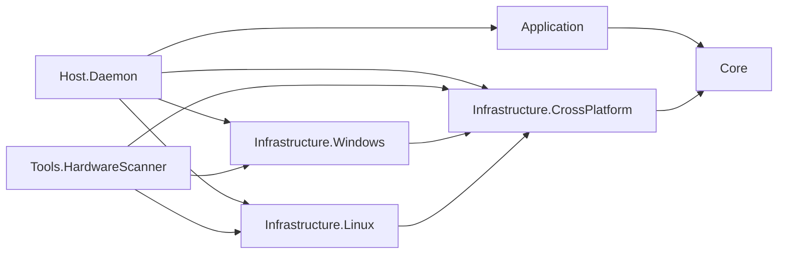

# RigForge — архитектура

Лёгкий кроссплатформенный (Windows 11 + Linux) демон и веб-конфигуратор, заменяющий SignalRGB / NZXT CAM / FanControl:

- **RGB** — единый пространственный 2D-холст: эффект рисуется один раз в управляемый буфер (`CanvasBuffer`, чистый C# `Span<uint>`/SIMD без `SkiaSharp`), каждый диод берёт цвет через предрасчитанную целочисленную таблицу билинейных весов (`PrecomputedTap`);
- **охлаждение** — кривые температура → скважность с гистерезисом, ramp up/down и failsafe;
- **экран СЖО** — виджеты телеметрии 240×240 (масштабируется до 320/640) в реальном времени (`SkiaSharp` инициализируется лениво только при наличии экрана или открытом превью).

Всё оборудование управляется **из user-mode** (USB HID, WinUSB/libusb, NVML). Драйверы ядра не используются; единственное
опциональное исключение — LibreHardwareMonitor с подписанным драйвером **PawnIO** (не WinRing0) для температуры CPU и Super I/O на Windows.

## Структура решения

```text
src/
  Core/                          доменные модели и порты, 0 зависимостей
  Application/                   движки: эффекты (60 FPS), охлаждение (1 Гц), LCD, телеметрия, профиль, валидация
  Infrastructure.CrossPlatform/  HID-транспорт, 19 семейств RGB (включая GPU I2C), OpenRGB SDK, NVML, libusb, JSON, WASM-эффекты
  Infrastructure.Windows/        DXGI Desktop Duplication, WASAPI Loopback, LibreHardwareMonitor (PawnIO), WinUSB, high-res таймер, Win32-сенсоры
  Infrastructure.Linux/          sysfs hwmon, X11/XWayland, PipeWire/PulseAudio, i2c-dev SMBus, clock_nanosleep, udev
  Host.Daemon/                   ASP.NET Core (Kestrel) + SignalR + REST/OpenAPI + BackgroundService-воркеры
  Tools.HardwareScanner/         CLI rigforge-scan: дамп HID, dry-run проба, сенсоры, udev, конфликты
tests/RigForge.UnitTests/        xUnit v3 (Microsoft.Testing.Platform)
ui/                              React 19 + TypeScript + Vite + Tailwind 4 + SignalR + react-konva
shell/                           Electron-окно конфигуратора (RigForge.exe), splash автозапуска демона, NSIS-инсталлятор
deploy/                          релизная сборка Setup/ZIP/tar.gz, Linux install/uninstall + .desktop, скрипты разработчика
.github/workflows/               CI/CD сборки и публикации GitHub Releases (release.yml)
docs/                            Postman-коллекция, руководство по установке и архитектурные спецификации
```



Платформенные модули подключаются в рантайме (`OperatingSystem.IsWindows()/IsLinux()`), поэтому одна сборка работает на обеих ОС;
Windows-классы помечены `[SupportedOSPlatform("windows")]`, и анализатор CA1416 следит за проверками.

### Порты Core

| Интерфейс | Назначение | Реализации |
| --- | --- | --- |
| `IRgbDevice` | зоны с нормализованными координатами LED, приём кадра | 19 семейств прямого кадра: HUE 2; Kraken X3 и Elite Ring; Aura, Mystic Light, Fusion 2.0, Polychrome; Corsair Node/Commander; UNI HUB; CM ARGB Gen2; FURY, ENE и Corsair DRAM; ASUS Aura, MSI Mystic Light и Gigabyte RGB Fusion на I2C видеокарты; HID++ Lightsync; Razer Chroma; QMK/VialRGB; opt-in OpenRGB SDK |
| `IFanController` | каналы вентиляторов/помпы, `SetDuty`, `RestoreDefault` | Kraken, HUE 2, LHM Super I/O, sysfs hwmon |
| `ISensorProvider` | телеметрия с семантическими ролями (`role:CpuTemperature`…) | Kraken, NVML, LHM, Win32, hwmon, /proc |
| `IAioLcdDevice` | экран СЖО: кадр RGBA, яркость, возврат на экран прошивки | Kraken Z3/2023/2024 |
| `IAudioLevelProvider` | до 16 полос спектра (0..1, бас → верх) и RMS; ленивый старт, 0 аллокаций на вызов | WASAPI Loopback (Windows), монитор sink PipeWire/PulseAudio через `libpulse-simple` (Linux); иначе `NullAudioLevelProvider` |
| `IScreenCapturer` | маленький BGRA-кадр рабочего стола для Ambilight | DXGI (Windows); X11/`XGetImage` через XWayland (Linux, 160×90, только при `DISPLAY` и `libX11.so.6`) |
| `IDeviceProbe` | обнаружение и инициализация семейства устройств | по одному на семейство, плюс `UnmanagedRgbControllerProbe` |
| `IProfileStore` | хранение профиля | JSON (`profile.json`) |
| `IPrecisionTimer` | точный сон рендер-цикла | `CREATE_WAITABLE_TIMER_HIGH_RESOLUTION` (Windows), `clock_nanosleep(CLOCK_MONOTONIC)` (Linux); иначе `Thread.Sleep` |

Одно физическое устройство реализует несколько интерфейсов поверх одного соединения (Kraken = вентиляторы + сенсоры + LCD).
Списки в `DeviceManager` фильтруются по флагам `Capabilities`, а не только по интерфейсу (например, Kraken, чей LCD занят другой программой).

## Потоки выполнения


- **Телеметрия** опрашивает провайдеров параллельно с таймаутом и защитой от повторного входа (`SemaphoreSlim(1, 1)` на провайдер); показание живёт до 15 с, свежесть проверяют потребители. Для температурных ролей (`CpuTemperature`, `GpuTemperature`, `LiquidTemperature`) выбирается максимальное валидное значение (`Max`), исключая выбор холодного iGPU вместо нагруженной дискретной видеокарты.
- **Эффекты** рендерятся на отдельном потоке (`AboveNormal`) в чистый C# буфер (`CanvasBuffer` без загрузки `libSkiaSharp`) с паузой через `IPrecisionTimer`. На Windows стандартный таймер 15,6 мс
  ограничил бы цикл ~32 FPS, поэтому используется `CREATE_WAITABLE_TIMER_HIGH_RESOLUTION` без глобального `timeBeginPeriod`. На Linux сон — `clock_nanosleep(CLOCK_MONOTONIC)`: после `EINTR` досыпается остаток.
  Кадр каждого устройства уходит через собственный диспетчер: медленный контроллер пропускает кадры, а не тормозит цикл;
  одинаковые кадры не отправляются (кроме keep-alive раз в 2 с). Статические эффекты рендерятся **один раз** и усыпляют поток до смены профиля/раскладки (`0%` CPU в простое), температурные просыпаются только по `TelemetryService.Updated` (1 Гц). `EffectSettings.Enabled = false` гасит диоды одним чёрным кадром и спит так же (`Blackout`).
- **Превью** (LED 20 FPS, LCD-PNG) считаются и отправляются только пока UI-клиент на них подписан (`SetPreview`); при отсутствии экранов и подписчиков `LcdRenderEngine` выгружает `SkiaSharp`-рендереры и спит на сигнале.
- Каждый цикл хостится `ResilientWorker`: исключение перезапускает именно этот цикл через 2 с — ошибка в LCD не остановит вентиляторы.
- Порядок hosted-сервисов: `HardwareLifecycleService` стартует первым (профиль → поиск устройств) и останавливается последним,
  уже после того как циклы вернули железо прошивке.

## Пространственный холст

- Холст — `VirtualCanvas` в абстрактных пикселях (по умолчанию 320×180); эффект рисуется ровно в этом разрешении.
- Каждая зона имеет `ZonePlacement` (x, y, width, height, rotation, enabled, ledCount). (x, y) — левый верхний угол
  неповёрнутого прямоугольника, поворот по часовой стрелке вокруг этого угла — та же семантика, что у узлов Konva в UI.
- Нормализованная позиция LED (0…1) → `X + lx·cos θ − ly·sin θ`, `Y + lx·sin θ + ly·cos θ`; цвет берётся билинейной выборкой.
- Несколько размещений с одним `(deviceId, zoneId)` и разными `segmentId` — части одной ARGB-цепочки: каждый сегмент стоит на холсте отдельно (`Linear`, `Ring` или `Matrix2D`), а в канал уходит их склейка в порядке `placements`. `DeviceColorCorrection` (гамма и баланс белого) применяется таблицей 3×256 после семплинга.
- Неразмещённые зоны автоматически раскладываются сеткой (`CanvasLayoutService`), UI получает «эффективный» холст.
- ARGB-разъёмы ASUS не сообщают длину ленты: число LED задаётся в редакторе (`ledCount`) и применяется через `TryResizeZone`.

## Охлаждение и безопасность

Регулятор канала: EMA-сглаживание → кривая → асимметричный гистерезис (рост применяется сразу, снижение — только после падения
на `HysteresisCelsius` ниже температуры, давшей текущую цель) → ограничение скорости изменения (%/с) → лимиты кривой.

| Защита | Поведение |
| --- | --- |
| Нет свежей температуры (> 5 с) | канал сразу в failsafe 100 % (без ramp) |
| Жидкость ≥ 60 °C | все управляемые каналы 100 % |
| Помпа | никогда ниже `max(минимум прошивки 20 %, MinimumPumpDutyPercent 30 %)` |
| Демон упал, держа низкие обороты Kraken | профиль в прошивке содержит «пол безопасности»: 70 % при 50 °C, 100 % от 55 °C |
| Остановка демона / удаление кривой | Kraken получает кривую по жидкости, HUE 2 — фикс. 60 %, Super I/O — `SetDefault()` (BIOS), hwmon — исходный `pwmN_enable` |
| LHM без прав/PawnIO отдаёт 0 °C | значение отбрасывается (иначе «холодный» CPU занизил бы обороты) → failsafe |

## Охват подсветки

Для production-ready программы обнаружение и прямое управление подсветкой — ключевая возможность, наравне с холстом и эффектами. У пользователей разные устройства на разных контроллерах, портах и драйверах. Один эффект и одна цветокоррекция должны попадать на каждую зону, которую демон умеет писать. Устройство, которое видно, но не принимает кадр, — пробел продукта: его подсветка остаётся цветом чужой прошивки.

Универсального драйвера «любой HID» нет и не планируется. Каждое семейство — свой `IDeviceProbe` и свой сборщик пакетов. Пишем только в регистры подсветки известного протокола и только туда, куда это позволяет железо. SPD, PMIC и неизвестные адреса SMBus не трогаем. Транспорты: USB HID, WinUSB/libusb, SMBus/I2C (PawnIO на Windows, `i2c-dev` на Linux) и собственная I2C-шина видеокарты (`nvapi64.dll` на Windows, PCI-ограниченный `i2c-dev` на Linux), которую NVML не отдаёт.

Кадр пишется в 19 семейств (раздел ниже). Манифест `devices/*.json` добавляет VID/PID в уже известное семейство. Новый протокол по-прежнему требует своей пробы и теста пакетов. Телеметрию GeForce отдаёт NVML, а партнёрская I2C-подсветка (ASUS, MSI, Gigabyte; RTX 30/40/50) пишется отдельным каналом `IGpuI2cBus`. Карта без известного контроллера не получает кадр и показывается как `DeviceSupportStatus.Unmanaged`.

`UnmanagedRgbControllerProbe` (этап 5) не пишет кадр. Vendor-HID известных RGB-вендоров (usage page ≥ `0xFF00`, отчёт не короче 8 байт), чей протокол ещё не реализован, остаётся в списке: имя, `VID:PID`, путь, `Capabilities = None`, `DeviceSupportStatus.Unmanaged`. Клавиатуры, мыши, аудио и consumer-интерфейсы отбрасываются. Один физический прибор — одна запись.

## Протоколы устройств

Байтовые форматы сверены с исходниками liquidctl (`kraken3.py`, `smart_device.py`) и OpenRGB (`AsusAuraUSBController`, `NZXTHue2Controller`).
Пакеты собираются чистыми функциями (`NzxtProtocol`, `AuraUsbProtocol`, `KrakenLcdUploader`), покрытыми тестами.

**NZXT (VID 0x1E71)** — 64-байтные HID-отчёты, report ID = байт команды, ответ = команда + 1.

- Kraken Z3/2023/2024: статус `74 01` → `75 …` (жидкость `[15] + [16]/10`, помпа RPM/duty `[17..19]`, вентиляторы `[23..25]`);
  скважность — профиль из 40 значений для 20…59 °C: `72 <канал 3 байта> <40 duty>`.
- Экран Kraken: HID-команды + bulk-endpoint `0x02` с заголовком `12 FA 01 E8 AB CD EF 98 76 54 32 10 <mode> 00 00 00 <len LE32>`.
  Kraken 2023 с прошивкой 2.x — прямая запись RGB565 big-endian (`36 01 00 01 06` … `36 02`), остальные — RGBX в один из 16 «бакетов»
  (RAM контроллера, износа нет) с переключением `38 01 04 <idx>`.
- HUE 2 (RGB Controller, Control Hub, RGB & Fan Controller, Smart Device V2): прямой режим `22 1g <1<<ch> 00 GRB×20` + `22 A0 …`,
  до 40 LED на канал; аксессуары из `21 03`; вентиляторы `62 01 <mask> <duty…>`, статус `67 02`.
- Kraken X3 (`0x2007` / `0x2014`, X53/X63/X73): кольцо и логотип, помпа с тем же полом безопасности, жидкость / RPM / duty. LCD нет. Только direct, во flash не пишется.
- Kraken 2024 Elite RGB (`0x3012`): 24 диода кольца помпы, кадр — пакет HUE 2 на канал `0` (`KrakenEliteRingChannel`). На хабе HUE 2 то же кольцо приходит аксессуаром `0x1E`.
- Windows: bulk-интерфейс Kraken привязан к WinUSB — используется нативный WinUSB API (как у liquidctl), без libusb DLL.
  Linux: libusb-1.0 через LibUsbDotNet.

**ASUS Aura USB (VID 0x0B05)** — 65-байтные отчёты с report ID `0xEC`, только HID-коллекция usage page `0xFF72`.
Конфиг-таблица `B0` (`[0x02]` — число ARGB-разъёмов, `[0x1B]` — LED платы), режим Direct `35 <effect ch> 00 00 FF`,
кадр `40 <direct ch | 0x80 apply | 0x10 overflow> <offset> <count> RGB×20`; канал платы — `0x04`. Прошивки `AULA3-AR32*`
нумеруют effect-каналы ARGB с нуля. Команда сохранения в flash (`3F 55`) никогда не отправляется.

**Kingston FURY DDR5 DRAM RGB (SMBus `0x60..0x63`)** — по 12 диодов на планку (`KingstonFuryDramProtocol`, по `KingstonFuryDRAMController` из OpenRGB):
- **Шина:** на Windows — подписанные модули `SmbusPIIX4.bin` (порты 0/1 AMD FCH) и `SmbusI801.bin` через `\\?\GLOBALROOT\Device\PawnIO` с глобальным мьютексом `Access_SMBUS.HTP.Method`; на Linux — `/dev/i2c-*` (`i2c-piix4` / `i2c-i801`).
- **Шесть барьеров безопасности (`SmbusSafetyGuard`):**
  1. до открытия SMBus нужна опознанная планка (`KF5*` из SMBIOS Type 17 или из кэша SPD EEPROM `/sys/bus/i2c/devices/*-005[0-7]/eeprom`, udev, EDAC). Пока совпадения нет, на шину уходит 0 байт — в том числе когда DMI не читается. `RequireSmbiosMatch: false` в `appsettings.json` — явный opt-in, по умолчанию true;
  2. жёсткий файрвол адресов разрешает только `0x60..0x63` (обращения к SPD5118 `0x50..0x57` и PMIC `0x48..0x4F` блокируются исключением до `DeviceIoControl`/`ioctl`);
  3. белый список регистров: чтение `0x01..0x04` (сигнатура `"FURY"` в старшем байте слова) и `0x06` (`0x10` Beast, `0x11` Renegade, `0x12` Beast White, `0x15` Beast2); запись только в SRAM контроллера (`0x08` = `0x53`/`0x44`, `0x09` = `0x10` Direct, `0x0B` = `0x00`, `0x20` яркость, `0x27` число слотов, `0x50..0x73` RGB);
  4. межпроцессная блокировка шины: мьютекс `Access_SMBUS.HTP.Method` на Windows; на Linux — реентерабельный `Monitor` и `flock(LOCK_EX)` прямо на уже открытом `/dev/i2c-*`, только на внешнем входе (`LinuxI2cSmbusController`). Если `flock` не взялся, `ioctl` не вызывается;
  5. пауза `3 мс` через `IPrecisionTimer` (high-res waitable timer на Windows, `clock_nanosleep` на Linux) только на границах транзакции (`0x08 = 0x53` / `0x44`), без задержки между регистрами `0x50..0x73` (по `Kingston Hyper Fury Ram.js` из SignalRGB — до 30 FPS плавного потока) + дифф-кэш регистров на каждый слот (неизменившиеся байты и повторные статичные кадры дают **0 транзакций SMBus**);
  6. read-only диагностика `rigforge-scan smbus` проверяет SMBIOS, PawnIO и сигнатуру `"FURY"` без смены режима подсветки.

**MSI Mystic Light USB (VID `0x1462`, `0x0DB0`)** — feature report 185 байт, report id `0x52` (OpenRGB `FeaturePacket_185`). Байт `save_data` (смещение 184) всегда 0: во flash не пишем.

**Gigabyte RGB Fusion 2.0 / ITE 8297 (VID `0x048D`)** — 64 байта, report id `0xCC`. Применение — летучий `0x28 0xFF`. Команды сохранения `0x29` и `0x30` не отправляются.

**ASRock Polychrome USB (VID `0x26CE`)** — 65 байт, report id `0x00`. `0x10` адресует зону платы, `0x12` — поток ARGB (канал, смещение, число, RGB). Пустой commit `0x12`, который у OpenRGB переживает цикл питания, не отправляется.

**Corsair HID (VID `0x1B1C`)** — Lighting Node / Commander Pro (usage page `0xFF00`, отчёт 65 байт, до 120 LED на канал) и Commander Core (usage page `0xFF42`, отчёты 65…1025, до 144 LED). Пакеты заполняют `Span<byte>` вызывающего. Возврат аппаратного эффекта летучий, flash не трогается.

**Lian Li UNI HUB (VID `0x0CF2`)** — report id `0xE0`. Заголовок direct: `0xE0 0x10 0x60 <channel>`. Цвета — команда `0x30 + channel`, тройки RGB или RBG. Во flash ничего не пишется.

**Cooler Master ARGB Gen2 (VID `0x2516`)** — 65 байт. Программный direct начинается с `[0x00, 0x80, …]`, чанки LED — команда `0x10`. Эффект во flash не сохраняется.

**ENE SMBus DRAM (Aura / Trident Z / Ballistix)** — только адреса `0x70..0x77` и `0x39..0x3C`. SPD `0x50..0x57` и PMIC `0x48..0x4F` режет `SmbusAddressFirewall`. 16-битный указатель ставится на регистр `0x00` (старший байт, затем младший), данные читаются с `0x81`. Порт данных `0x01` открывается после сигнатуры `AUDA` / `ENE ` / `DIMM`. Direct: `0x8021 = 0x01`, затем `0x8020 = 0x01`. Байты LED по `0x8100` идут в порядке R, B, G.

**Corsair Vengeance / Dominator SMBus DRAM** — адреса `0x58..0x5F`, строго выше SPD. Перед direct читаются vendor `0x43 == 0x1B` и model `0x44 == 0x04`. Цвета: `0x31` включает режим, `0x32` применяет кадр; оба значения летучие. Импульс apply не кэшируется и уходит снова, когда цвет реально изменился.

**GPU I2C RGB (ASUS Aura `0x67`, MSI Mystic Light `0x68`, Gigabyte RGB Fusion `0x75`/`0x71`)** — RGB-контроллер видеокарты сидит на её собственной I2C-шине (`IGpuI2cBus`), отдельной от SMBus материнской платы, поэтому запись подсветки не может попасть в SPD/PMIC. Карты опознаются по PCI-идентификатору и subsystem (`GpuPciCatalog`, RTX 30/40/50, плюс манифесты `devices/*.json` с `subVendorId`/`subDeviceId`/`i2cAddress`); незнакомая карта ASUS (только десктопная, не `Laptop`/`Mobile`) принимается после чисто читающей проверки ENE-контроллера и имени `AUMA…`/`AURA…` (без записи режима/цвета, только выбор указателя регистра); отвергнутые карты запоминаются и не опрашиваются повторно при hotplug-рескане. Linux-шина получает стабильный `BusId = pci-<адрес>` и открывается через сырой `open(O_RDWR | O_CLOEXEC)` без неявного `flock` от .NET. Транспорты: на Windows — пользовательский `nvapi64.dll` из драйвера NVIDIA (`NvAPI_I2CReadEx`/`NvAPI_I2CWriteEx`, внутренний порт 1, `NV_I2C_INFO_V3` 64 байта, DDC-порты не используются), **без прав администратора и без PawnIO**; на Linux — PCI-ограниченный `/dev/i2c-*` (`I2C_RDWR`, только внутренний адаптер `NVIDIA i2c adapter 1` под дискретным дисплейным контроллером `10de`, DDC/DP/HDMI/AUX отбрасываются) с реентерабельным `Monitor` и `flock(LOCK_EX)`. На шину допускаются только адреса `0x60..0x77` (`GpuI2cAddressFirewall`: EDID/DDC `0x50..0x57` и всё ниже `0x60` блокируются исключением до обращения к драйверу). `AcquireBusLock()` отдаёт один предвыделенный scope (на Windows ещё мьютекс `Access_PCI`), так что кадр идёт без аллокаций. Режим Direct не сохраняется во flash; при снятии зоны возвращается аппаратная радуга. Read-only диагностика `rigforge-scan gpu-i2c` читает имя контроллера и число LED без смены режима и цвета (RTX 5070 Ti TUF GAMING: `AUMA0-E6K5-1107`, 4 LED).

**Logitech Lightsync HID++ 2.0 (VID `0x046D`)** — длинный отчёт `0x11`, 20 байт, usage page `0xFF00` / usage `0x0002`. Эффекты зон летучие, onboard-профиль не пишется.

**Razer Chroma HID (VID `0x1532`)** — payload 90 байт (91 с report id): статус, transaction id, размер, класс и id команды, 80 байт аргументов, XOR CRC по payload `[2..87]` в `[88]`. Custom-frame летучий, профиль не сохраняется.

**QMK / VialRGB** — raw HID, usage page `0xFF60`, usage `0x0061`. Отчёт 33 байта: report id `0x00` и 32 байта VIA. Direct только в RAM. Lighting-save `0x09` не отправляется. На проводе цвет — 8-битный HSV (hue 0..255, не градусы).

**OpenRGB SDK (opt-in)** — TCP. Кадр: `"ORGB"` + little-endian индекс устройства, id пакета и длина; цвет LED — RGBX (`R, G, B, 0x00`). Клиент молчит, пока не задан `RIGFORGE_OPENRGB_ENDPOINT` или `Hardware:OpenRgb:Enabled=true`. Закрытый порт даёт пустой список.

Контроллер без своего писателя сюда не входит: его показывает `UnmanagedRgbControllerProbe` со статусом `Unmanaged`.

## Библиотека эффектов и аудио

17 встроенных эффектов. Процедурные считают цвет только в точках диодов (`TrySamplePoints`, буферы кадра выделены заранее — 0 аллокаций на кадр). Холст растеризуется у `ambilight`: ему нужен кадр рабочего стола. Внешние модули садятся в категорию `Custom`.

| Категория | Эффекты |
| --- | --- |
| `Static` | `solid` |
| `Flowing` | `rainbow-wave`, `gradient`, `breathing`, `spectrum-cycle`, `aurora`, `cyber-wave`, `fire-lava`, `starlight` |
| `Spatial` | `spiral-vortex`, `radial-pulse`, `plasma-storm`, `matrix-rain`, `meteor-scanner` |
| `Reactive` | `temperature`, `ambilight`, `audio-reactive` |
| `Custom` | WASM: `{DataDirectory}/effects/*.wat\|*.wasm` рядом с `.json`; совпадение `id` со встроенным пропускается |

Схема `EffectParameterDefinition`: `ColorList`, `FloatRange`, `IntRange`, `Boolean`, `Select`, `SensorSelector`. Форма UI и `RigProfileValidator` строятся по ней. Значения лежат в `EffectSettings.Parameters`; `profile.json` мигрирует со `schemaVersion` 1 на 2.

`IAudioLevelProvider.ReadSpectrum` отдаёт до 16 полос (бас → верх, 0..1) и RMS. FFT 256, окно Ханна, без аллокаций на вызов. WASAPI loopback (Windows) и монитор sink через `libpulse-simple` (PipeWire `pipewire-pulse` или PulseAudio) открываются на первом чтении и отпускают устройство через 5 с простоя. Нет библиотеки — `IsSupported = false`, исключения нет. Спектр запрашивает только `audio-reactive`.

`EffectSettings.Enabled = false` — master blackout: один чёрный кадр и сон потока (`EffectRenderMode.Blackout`, 0 % CPU). Яркость в профиле сохраняется. `TriggerIdentify` и `POST /api/devices/{deviceId}/identify?zoneId=` будят цикл и мигают устройство или одну зону 4 Гц (полупериод `Stopwatch.Frequency / 8`, циан `00F5FF` / тёмный `0A1018`) около 2 с, в том числе при выключенной подсветке и статическом эффекте. Пустой `zoneId` мигает все зоны устройства.

## UI (ui/)

React 19 + TypeScript 6 (strict, `noUncheckedIndexedAccess`) + Vite 8 + Tailwind 4 + `@microsoft/signalr` + react-konva + zod.
TypeScript закреплён на 6.0: typescript-eslint пока не поддерживает 7.x.

- `api/` — контракт (`contracts.ts`, зеркало `Dtos.cs`), типизированный `DaemonClient` (бесконечный реконнект, повторная подписка
  на превью после переподключения), zod-схемы (лимиты не мягче серверных валидаторов).
- `state/` — Context + `useReducer` для состояния, телеметрии и статуса вентиляторов; поток LED-превью 20 FPS хранится вне reducer
  (`ledPreviewStore` + `useLedPreview`), поэтому перерисовывается только слой диодов.
- `features/lighting` — Effect Gallery (`EffectGallery`): вкладки пяти категорий, поиск, карточки с живым `EffectMiniPreview` и курируемые палитры (`palettes.ts`: Cyberpunk, Synthwave, Northern Lights, Inferno, Arctic Ice, Matrix, ROG Crimson, Vaporwave).
  Spatial Canvas (`LayoutStage`, `layoutModel`): zoom 0.5–3 с шагом 0.25, pan, snap 0 / 5 / 10 px, силуэты железа (`ZoneSilhouette` по топологии и имени), пресеты 320×180 (16:9), 240×240 (корпус), 400×225 (XL), 480×270 (HD). Перетаскивание, resize, поворот с шагом 15°, длина ARGB-лент.
- `features/lcd` — общий `Lcd` и per-device override `Displays[deviceId]` (`LcdDeviceList`). Нет записи — экран берёт общий профиль. Живое превью кадра.
- `features/devices` — центр управления: вкладки All, Active Control (`Supported`), Sensors Only (`TelemetryOnly`), Detected (`Unmanaged`); Blink / Identify на устройство и зону; `ProfileTransferBar` (import/export профиля); на Linux `PlatformSetupModal` с udev, `modprobe i2c-dev` и `install-linux.sh`.
- `features/dashboard` — Live Performance Showcase (`PerformanceShowcase`, `GET /api/performance`): режим рендера, время кадра, CPU, Private RAM, GC. Ориентир витрины при прямом семплинге — ~2–5 µs/frame, ~0,0–0,4 % CPU, ~55–65 МБ Private RAM против 650–900 МБ у WebView-наборов (`WEBVIEW_SUITE_RAM_MB`). Таблица в «Память и размер» — отдельный dry-run замер через 20 с после старта.
- `features/cooling` — SVG-редактор кривой с живым маркером, пресеты для помпы и вентиляторов.
- Тесты UI — Vitest (`npm test` в `ui/`): `effectModel`, `layoutModel`, `devicesModel`, `schemas`, `performanceStore`.
- Ошибки — `ErrorBoundary` на каждую страницу и тосты с текстом `HubException`. Страница Lighting (Konva) грузится лениво.

Dev: Vite на :5173 проксирует `/hubs` (WebSocket) и `/api` на демон. Prod: `npm run build` пишет в `src/Host.Daemon/wwwroot`,
демон отдаёт UI сам (`/` + SPA-fallback), OpenAPI в Production скрыт.

## Ключевые решения

| Решение | Почему |
| --- | --- |
| .NET 10 (LTS) вместо 8/9 | на машине установлен только .NET 10; поддержка .NET 8 и 9 заканчивается 10.11.2026. TFM задан в `Directory.Build.props` |
| Демон как задача «при входе», не служба | DXGI Desktop Duplication не работает из session 0; повышенные права нужны LHM/PawnIO. `AddWindowsService()` оставлен для headless-режима без Ambilight |
| Ручной маппинг DTO вместо AutoMapper, без MediatR | процесс-демон с одним хабом; обе библиотеки стали коммерческими; ручные проекции дешевле и совместимы с trimming/AOT |
| FluentValidation + ProblemDetails | единая валидация профиля для SignalR (`HubException`) и REST (`ValidationProblem`) |
| Документы профиля без отдельных DTO | `RigProfile` и его части — неизменяемые записи настроек: тот же формат на диске и в API, валидируются целиком |
| Проверка `Origin` + host filtering | WebSocket не защищён CORS: без этого любая веб-страница могла бы через 127.0.0.1 менять кривые вентиляторов (localhost CSRF), а DNS-rebinding — обойти проверку хоста |
| `Hardware:DryRun` | обнаружение и сенсоры без записи в RGB/вентиляторы/LCD — для первого запуска рядом с vendor-софтом и диагностики |
| `nuget.config` только с nuget.org | на машине есть корпоративные фиды; source mapping исключает dependency confusion |

## Память и размер (замеры на этой машине, dry-run, 20 с после старта)

| Конфигурация | Private, МБ | Working Set, МБ |
| --- | ---: | ---: |
| Ядро (ASP.NET Core + SignalR + SkiaSharp + движки), без железа | 20,1 | 64,5 |
| + NZXT, ASUS, LibreHardwareMonitor | ≈ 23 | ≈ 79 |
| + NVML (всё включено) | 43–46 | ≈ 102 |

Цель 20–30 МБ выполняется для ядра и USB-устройств; **NVML добавляет ≈ 20 МБ** нативной памяти драйвера (`Hardware:Nvidia:Enabled=false`
отключает). Управляемая куча — 5–8 МБ. Working Set включает разделяемые страницы DLL (CoreLib, SkiaSharp, nvml.dll).
Workstation GC без фонового потока; `DOTNET_GCgen0MaxBudget=0x400000` экономит ещё ~3 МБ (на Linux задано в unit-файле;
ключ в runtimeconfig рантайм не принимает). Release ведёт себя так же (≈ 49 МБ private со всем железом).
CPU: 2,6 % одного ядра при 60 FPS эффекта на 7 зонах. Framework-dependent publish для win-x64 — 22 МБ
(нативные PDB из пакетов, в т.ч. 92 МБ `libSkiaSharp.pdb`, исключаются).

## Установка, автозапуск и удаление (Windows 11 + Linux)

### Пользовательский инсталлятор Windows (`RigForge-Setup-<version>-win-x64.exe`)

Для конечных пользователей собирается самодостаточный (`--self-contained true`, без требования доустанавливать .NET 10 / ASP.NET Core Runtime) пошаговый инсталлятор **Assisted NSIS** (`electron-builder` + `shell/build/installer.nsh`):

1. **Шаги мастера установки:**
   - выбор папки установки (по умолчанию `C:\Program Files\RigForge`);
   - кастомная страница опций: чекбоксы **«Start RigForge automatically when I sign in to Windows»** (включён по умолчанию; при обновлении считывает предыдущий выбор из `HKLM\Software\RigForge\AutostartOnSignIn`) и **«Create a Desktop shortcut»** (включён по умолчанию); ярлык в меню «Пуск» с `rigforge.ico` создаётся всегда;
   - штатная остановка предыдущего экземпляра (`POST /api/host/shutdown`, ожидание возврата кривых охлаждения и экрана СЖО прошивке), распаковка `RigForge.exe`, `RigForge.Daemon.exe`, `rigforge-scan.exe`, `wwwroot/` и `effects/`, регистрация задачи Планировщика `\RigForge` и добавление записи в «Установленные приложения» Windows (`HKLM\...\Uninstall`).
   - поддерживаются тихие ключи: `/S`, `/AUTOSTART=0|1`, `/NODESKTOP=1`, `/D=<путь>`.
2. **Модель привилегий и запуск с ярлыка без повторного UAC:**
   - демон регистрируется в Планировщике заданий как `\RigForge` (`InteractiveToken` + `HighestAvailable`), привязываясь к владельцу интерактивного процесса `explorer.exe` (защита от over-the-shoulder UAC).
   - сама задача всегда остаётся в `Settings.Enabled = true` и `AllowStartOnDemand = true` с SDDL-правом `FRFX` для интерактивного пользователя, а опция «Запускать при входе в систему» переключает только `LogonTrigger.Enabled`.
   - при двойном клике по ярлыку `RigForge` (`RigForge.exe`), если демон уже работает (`/api/health`), окно мгновенно открывает дашборд. Если демон остановлен (автозапуск выключен или нажат `Exit` в трее), открывается `splash.html`, демон поднимается через `schtasks /Run /TN "RigForge"` **без запроса UAC** (если задачи нет — `RigForge.Daemon.exe --run-elevated` показывает обычный UAC; кнопки `Start RigForge (Retry)` / `Quit`), и после готовности `/api/health` загружается дашборд.
   - закрытие окна крестиком завершает только процесс Electron, оставляя `RigForge.Daemon.exe` управлять оборудованием в системном трее. Повторный старт `RigForge.Daemon.exe` перехватывается `SingleInstanceMutex` и просто открывает окно дашборда.
3. **Управление автозапуском после установки:**
   - в контекстном меню системного трея (`Open dashboard`, **`Start with Windows`**, `Exit`);
   - в диалоге **System & Startup** на вкладке `Devices` в UI (`SetAutostart` в SignalR и `GET/PUT /api/host/autostart`, синхронизация между клиентами через `StateChanged`).
4. **Деинсталляция (`Installed apps` → `RigForge` → `Uninstall`):**
   - отдельная страница подтверждения предлагает опцию удаления пользовательских данных `%LOCALAPPDATA%\RigForge` (`profile.json`, `devices\`, `effects\`); **по умолчанию галочка снята** и профили сохраняются (в тихом режиме очистка включается только ключом `/PURGE=1`; при обновлении `--updated` данные и задача не удаляются);
   - перед удалением файлов демон останавливается штатно через `POST /api/host/shutdown` (защищён от браузерного CSRF запретом `Origin`, `Referer`, `Sec-Fetch-Site`), возвращая вентиляторы и экран СЖО прошивке, после чего удаляются задача `\RigForge`, ярлыки, кэш `%APPDATA%\RigForge` и файлы программы.

## Сборка и запуск для разработчика

```powershell
# демон (dev): Kestrel на http://127.0.0.1:5757, dry-run профиль есть в launchSettings
dotnet run --project src/Host.Daemon
# UI (dev): http://localhost:5173, /hubs и /api проксируются на демон
cd ui; npm install; npm run dev
# диагностика (dry-run, ничего не пишет в RGB/вентиляторы/LCD)
dotnet run --project src/Tools.HardwareScanner -- hid
dotnet run --project src/Tools.HardwareScanner -- smbus
dotnet run --project src/Tools.HardwareScanner -- sensors --watch
# тесты (C# + UI + Electron shell)
dotnet test --project tests/RigForge.UnitTests
cd ui; npm test
cd ../shell; npm test
# полная сборка релиза (RigForge-Setup-<ver>-win-x64.exe, portable .zip, linux .tar.gz, SHA256SUMS.txt)
.\deploy\Build-Release.ps1
# установка на Windows — запуск собранного exe, не скрипта
.\artifacts\RigForge-Setup-<ver>-win-x64.exe
```

Перед запуском закройте NZXT CAM, SignalRGB и LightingService (Armoury Crate) — демон предупреждает о них в UI и логе.

## Linux и дистрибуция

`LinuxI2cSmbusController` открывает чипсетный `/dev/i2c-N` (`i2c-piix4` / `i2c-i801`) и держит тот же контракт лока, что `PawnIoSmbusController`: `AcquireBusLock` реентерабелен на вызывающем потоке (`Monitor`). Межпроцессный `flock(LOCK_EX)` берётся на самом файловом дескрипторе `/dev/i2c-*` и только на внешнем входе. Отдельного lock-файла нет: блокировка ядра общая для всех процессов, открывших этот же `/dev/i2c-N`, и у неё нет symlink-поверхности в `/tmp`. Если `flock` вернул ошибку (после повтора `EINTR`), передача не начинается и `ioctl` не вызывается.

Инвентарь планок без root: сначала SMBIOS Type 17 из `/sys/firmware/dmi/tables/DMI`. Если таблица недоступна, подбираются кэш SPD EEPROM (`/sys/bus/i2c/devices/*-005[0-7]/eeprom`), кэш udev (`/run/udev/data`) и EDAC (`/sys/devices/system/edac`). Совпавшая планка из любого из этих источников разрешает открыть SMBus. Нечитаемый DMI при пустом кэше шину не открывает: `SmbusProbePolicy.AllowsBusProbe` при `RequireSmbiosMatch: true` (значение по умолчанию) возвращает true только когда есть совпавшая планка. `CanReadSmbios = false` — диагностика, не разрешение на проб. Пустая, но читаемая таблица ошибкой прав не считается.

Правило `SUBSYSTEM=="dmi", KERNEL=="id"` в `deploy/linux/60-rigforge.rules` выставляет чтение на `/sys/firmware/dmi/tables/DMI` (и на точку входа SMBIOS). В таблице есть серийные номера; правило добавляет только бит чтения. Явный отказ от проверки личности планки — `Hardware:KingstonFury:RequireSmbiosMatch`, `Hardware:EneDram:RequireSmbiosMatch` или `Hardware:CorsairDram:RequireSmbiosMatch` равные `false` в `appsettings.json`. SPD `0x50..0x57` и PMIC по-прежнему закрыты `SmbusAddressFirewall`.

Захват Ambilight — `LinuxX11ScreenCapturer` (X11 и XWayland, 160×90 BGRA). Сессия без `DISPLAY` или без `libX11.so.6` сообщает `IsSupported = false` и не бросает исключение. Аудио — монитор sink: один и тот же `libpulse-simple` у PulseAudio и у PipeWire. Сон цикла — `clock_nanosleep(CLOCK_MONOTONIC)`.

- `deploy/linux/install-linux.sh` — работает как из распакованного релизного архива `rigforge-linux-x64-<ver>.tar.gz`, так и из репозитория (Debian/Ubuntu, Fedora/RHEL, Arch/CachyOS, openSUSE). Кладёт демон и лаунчер `rigforge-open` в `~/.local/share/rigforge`, ставит `60-rigforge.rules`, `modules-load.d` и `modprobe` для `i2c-dev` / `i2c-piix4` / `i2c-i801`, регистрирует user unit `rigforge.service` (ключ `--no-autostart` пропускает автозапуск при входе) и создаёт ярлык меню приложений `~/.local/share/applications/rigforge.desktop` с иконкой `rigforge.svg`. Профиль в `~/.config/rigforge` не трогает.
- `deploy/linux/uninstall-linux.sh` — останавливает и удаляет службу, правила udev, `.desktop`-ярлык и файлы программы; профили в `~/.config/rigforge` сохраняются, если не передан флаг `--purge`.
- `deploy/Build-Release.ps1`, `deploy/build-release.sh` и `.github/workflows/release.yml` — собирают self-contained релизные артефакты (`RigForge-Setup-<ver>-win-x64.exe`, `rigforge-win-x64-<ver>.zip`, `rigforge-linux-x64-<ver>.tar.gz`, `SHA256SUMS.txt`) и публикуют их в GitHub Releases по тегу `v*`.

Вручную по-прежнему достаточно `rigforge-scan udev -o 60-rigforge.rules` в `/etc/udev/rules.d/` и user unit `deploy/linux/rigforge.service`.

## Состояние и ограничения MVP

Проверено на целевом ПК (read-only/dry-run): обнаружены Kraken 2023 (`1E71:300E`, прошивка 2.0.0), NZXT RGB Controller (`1E71:2012`,
2× F140 RGB), NZXT Control Hub (`1E71:2022`, 5 вентиляторных каналов, F120 RGB), ASUS Aura (`0B05:19AF`, `AULA3-AR32-0309`, 3 ARGB),
Kingston FURY DDR5 RGB (`kingston-fury-ddr5:piix4-0:1-3`, шина `PIIX4 port 0` `0x0B00`, слоты `0x61` и `0x63`, модель `0x10`, `KF556C40-32`, 2×12 LED),
Super I/O `Nuvoton NCT6701D` на `ASUS ROG STRIX B850-E GAMING WIFI` (7 каналов) и `AMD Ryzen 7 9800X3D` через PawnIO `2.2.0.0`,
RTX 5070 Ti через NVML; статус Kraken и Control Hub разобран корректно. UI проверен в браузере против реального демона:
живые сенсоры, раскладка реальных зон с потоковым LED-превью, кривая помпы (28,4 °C → 47 %), живое превью LCD.

Живой тест (без dry-run, вентиляторы не трогались): плавный rainbow-wave на Aura (плата + ARGB), на NZXT RGB Controller и Control Hub
(контроллер подтверждает кадры отчётами `FF 01 … 22 10 / 22 A0`), на планках ОЗУ Kingston FURY DDR5 RGB (`0x61` и `0x63` по SMBus через PawnIO, до 30 FPS без рывков)
и дашборд на экране Kraken 2023 (FW 2.x, поток RGB565 через WinUSB) подтверждены визуально; ошибок в логе нет.

Не проверено на железе: установка скважности помпы и вентиляторов (намеренно не трогались). Скважность для портов 4–5
Control Hub — экстраполяция формата `62 01` на 5 каналов.

Остаётся за кадром этого прогона: управление вентиляторами GPU, Native AOT, восстановление яркости LCD, бывшей до запуска (сейчас из профиля, 80 %). Подсветка GeForce пишется собственным I2C-каналом (ASUS Aura / MSI Mystic Light / Gigabyte RGB Fusion, см. «Протоколы устройств»); NVML остаётся телеметрией, партнёрский USB без протокола показывается как `Unmanaged`. Полноэкранные игровые эффекты (*Pong*, *Mario*) и отдельное WebGL-превью в UI в рантайм не входят: семплинг считает демон, мини-превью галереи рисует canvas 2D.

## Дорожная карта развития (Public Distribution & Custom Effects)

Спецификации и планы этапов зафиксированы в `docs/superpowers/specs/`:
1. **Этап 1 (Реализовано):** перевод RGB-рендерера на чистый C# (`CanvasBuffer` + `PrecomputedTap`) без `SkiaSharp`, Event-Driven сон фоновых воркеров, разделение локов чтения/записи HID, пулинг `LibUsb` (0 аллокаций в LOH), батч-мьютекс SMBus, разрешение температурных ролей по `Max` и посекционное восстановление повреждённого `profile.json`.
2. **Этап 2 (Реализовано):** декларативный каталог `IDeviceManifestCatalog` (`JsonDeviceManifestCatalog` + внешние JSON-манифесты в `%LOCALAPPDATA%\RigForge\devices\*.json`), неразрушающий Delta-рескан `DeviceManager` с подпиской на USB hotplug, универсальный `SmbusAddressFirewall`, прямой парсер `SmbiosType17Parser` (`GetSystemFirmwareTable('RSMB')` без `new SMBios()`) и отключение 24-часовых буферов истории `LibreHardwareMonitor` (~47–52 МБ Private Working Set со всеми 9 устройствами).
3. **Этап 3 (Реализовано — `2026-11-01-custom-effects-and-zero-alloc-rgb-design.md`):**
   - **Кастомные эффекты (Реализовано):** 17 встроенных эффектов в категориях `Static`, `Flowing`, `Spatial`, `Reactive` и WASM-каталог `Custom`, включая `audio-reactive` на 16 полосах. Полноэкранные игровые холсты (*Pong*, *Mario*) и отдельное WebGL-превью в этот рантайм не входили.
   - **WASM-песочница прямого семплинга (Реализовано):** `{DataDirectory}/effects/*.wat|*.wasm` рядом с одноимённым `.json`. Wasmtime без WASI и без импортов, память 32-бит с максимумом не больше 32 страниц (2 МиБ), топливо на старт модуля и на каждый `sample`. Гость пишет `0x00RRGGBB` только в точки реальных диодов; `Engine` не создаётся, если каталог пуст. Совпадение `id` со встроенным эффектом пропускается. Пример: `effects/wasm-plasma`.
   - **Direct LED Sampling и схема параметров (Реализовано):** двухрежимный `IEffect.TrySamplePoints` — процедурные эффекты считают цвет только в координатах реальных диодов (`LedPoint` предвычисляются в `LedSamplePlan`, 0 аллокаций на кадр), холст растеризуется только для эффектов, отказавшихся от семплинга (`Ambilight`). Параметры описываются схемой `EffectParameterDefinition` (`ColorList`, `FloatRange`, `IntRange`, `Boolean`, `Select`, `SensorSelector`), значения хранятся в `EffectSettings.Parameters` (JSON), UI-форма и валидатор строятся по схеме; `profile.json` мигрирует со `schemaVersion` 1 на 2 (старые плоские поля сворачиваются в `Parameters` конвертером). `Enabled = false` гасит подсветку и усыпляет цикл.
   - **Zero-Allocation протоколы (Реализовано):** `AuraUsbProtocol.WriteDirectPacket`, `NzxtProtocol.WriteHue2Packet` и `KingstonFuryDramProtocol.BuildFrameWrites` пишут пакеты и SMBus-команды напрямую в буфер вызывающего (`Span<byte>` / предвыделенный `KingstonRegisterWrite[]`), 0 аллокаций на кадр после прогрева для удержания управляемой кучи C# на уровне ~7–8 МБ при многочасовой работе. Писатели семейств этапа 5 заполняют тот же буфер вызывающего и не шлют команду сохранения во flash.
   - **Сегментирование ARGB-цепочек, Matrix2D и цветокоррекция (Реализовано):** один физический ARGB-порт раскладывается на независимые `ZonePlacement` (`segmentId`, своё положение и топология) в порядке цепочки; `LedTopology.Matrix2D` строит построчную сетку, `Serpentine` разворачивает нечётные ряды. Сумма `ledCount` сегментов меняет размер зоны. На устройство задаётся `DeviceColorCorrection` (гамма 0.5..3 и баланс белого `#RRGGBB`): `LedSamplePlan` заранее считает три таблицы по 256 байт и применяет их при прямом семплинге и при чтении холста без аллокаций на кадр.
4. **Этап 4 (Реализовано):** per-device LCD `RigProfile.Displays[deviceId]` (до 16 записей). `LcdRenderEngine` берёт override устройства, иначе общий `Lcd`. REST: `PUT` и `DELETE /api/profile/displays/{deviceId}`. Экран Kraken отдаёт поток `Rgb565` или RGBX-бакет; виджеты рисуются в `Rgba8888`; превью холста подсветки — JPEG. Экраны остаются `IAioLcdDevice` с размером из `LcdInfo`.
5. **Этап 5 (Реализовано):** прямой кадр на 16 семейств из раздела «Протоколы устройств» (плюс 3 семейства GPU I2C) и карточка обнаруженного, но ещё не управляемого vendor-HID через `UnmanagedRgbControllerProbe` (`DeviceSupportStatus.Unmanaged`, имя и путь). NVML остаётся телеметрией; подсветка видеокарты идёт собственным каналом GPU I2C. Новый VID/PID известного семейства подключается манифестом. Новый протокол добавляется пробой и тестом пакетов по OpenRGB или liquidctl и проверяется на железе до того, как зона попадает в профиль.
