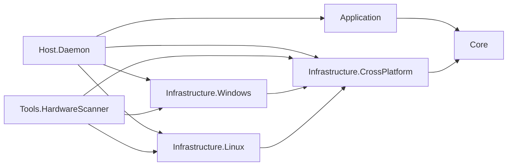
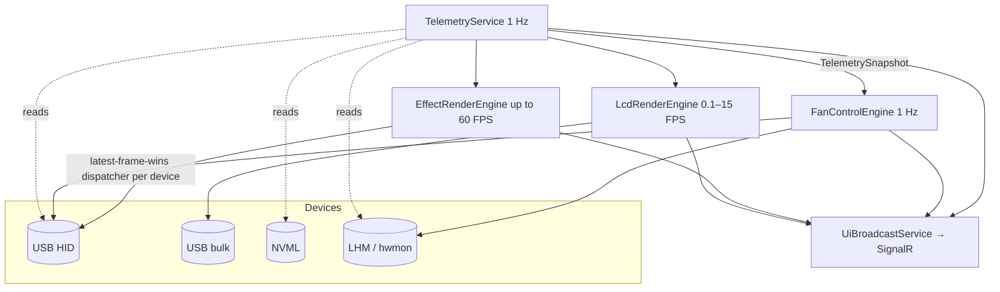

# RigForge — architecture

A small cross-platform (Windows 11 and Linux) daemon and web configurator that replaces SignalRGB, NZXT CAM, and FanControl:

- **RGB** — one spatial 2D canvas. The effect is drawn once into a managed buffer (`CanvasBuffer`, plain C# `Span<uint>` / SIMD, no `SkiaSharp`). Each LED takes its color from a precomputed integer table of bilinear weights (`PrecomputedTap`).
- **Cooling** — temperature-to-duty curves with hysteresis, ramp up/down, and a failsafe.
- **AIO screen** — live telemetry widgets at 240×240 (scaled to 320/640). `SkiaSharp` is initialized lazily, and only when a screen is present or a preview is open.

All hardware is driven **from user mode** (USB HID, WinUSB/libusb, NVML). There is no kernel driver. The only optional exception is LibreHardwareMonitor with the signed **PawnIO** driver (not WinRing0) for CPU temperature and Super I/O on Windows.

## Solution layout

```text
src/
  Core/                          domain models and ports, zero dependencies
  Application/                   engines: effects (60 FPS), cooling (1 Hz), LCD, telemetry, profile, validation
  Infrastructure.CrossPlatform/  HID transport, 19 RGB families (including GPU I2C), OpenRGB SDK, NVML, libusb, JSON, WASM effects
  Infrastructure.Windows/        DXGI Desktop Duplication, WASAPI loopback, LibreHardwareMonitor (PawnIO), WinUSB, high-res timer, Win32 sensors
  Infrastructure.Linux/          sysfs hwmon, X11/XWayland, PipeWire/PulseAudio, i2c-dev SMBus, clock_nanosleep, udev
  Host.Daemon/                   ASP.NET Core (Kestrel) + SignalR + REST/OpenAPI + BackgroundService workers
  Tools.HardwareScanner/         rigforge-scan CLI: HID dump, dry-run probe, sensors, udev, conflicts
tests/RigForge.UnitTests/        xUnit v3 (Microsoft.Testing.Platform)
ui/                              React 19 + TypeScript + Vite + Tailwind 4 + SignalR + react-konva
shell/                           Electron configurator window (RigForge.exe), daemon splash, NSIS installer
deploy/                          release build of Setup/ZIP/tar.gz, Linux install/uninstall + .desktop
.github/workflows/               CI build and GitHub Release publish (release.yml)
docs/                            Postman collection and the install guide
```



Platform modules are selected at runtime (`OperatingSystem.IsWindows()` / `IsLinux()`), so one build runs on both operating systems. Windows classes are marked `[SupportedOSPlatform("windows")]`, and analyzer CA1416 checks the guards.

### Core ports

| Interface | Role | Implementations |
| --- | --- | --- |
| `IRgbDevice` | zones with normalized LED coordinates, accepts a frame | 19 direct-frame families: HUE 2; Kraken X3 and Elite Ring; Aura, Mystic Light, Fusion 2.0, Polychrome; Corsair Node/Commander; UNI HUB; CM ARGB Gen2; FURY, ENE, and Corsair DRAM; ASUS Aura, MSI Mystic Light, and Gigabyte RGB Fusion on GPU I2C; HID++ Lightsync; Razer Chroma; QMK/VialRGB; opt-in OpenRGB SDK |
| `IFanController` | fan and pump channels, `SetDuty`, `RestoreDefault` | Kraken, HUE 2, LHM Super I/O, sysfs hwmon |
| `ISensorProvider` | telemetry with semantic roles (`role:CpuTemperature`, …) | Kraken, NVML, LHM, Win32, hwmon, /proc |
| `IAioLcdDevice` | AIO screen: RGBA frame, brightness, return to the firmware screen | Kraken Z3/2023/2024 |
| `IAudioLevelProvider` | up to 16 spectrum bands (0..1, bass to treble) and RMS; lazy start, zero allocations per call | WASAPI loopback (Windows), PipeWire/PulseAudio sink monitor through `libpulse-simple` (Linux); otherwise `NullAudioLevelProvider` |
| `IScreenCapturer` | a small BGRA desktop frame for Ambilight | DXGI (Windows); X11/`XGetImage` through XWayland (Linux, 160×90, only when `DISPLAY` and `libX11.so.6` exist) |
| `IDeviceProbe` | discover and initialize one device family | one per family, plus `UnmanagedRgbControllerProbe` |
| `IProfileStore` | profile storage | JSON (`profile.json`) |
| `IPrecisionTimer` | precise sleep for the render loop | `CREATE_WAITABLE_TIMER_HIGH_RESOLUTION` (Windows), `clock_nanosleep(CLOCK_MONOTONIC)` (Linux); otherwise `Thread.Sleep` |

One physical device implements several interfaces over one connection (Kraken = fans + sensors + LCD). Lists in `DeviceManager` are filtered by `Capabilities` flags, not only by interface (for example a Kraken whose LCD is held by another program).

## Execution loops



- **Telemetry** polls providers in parallel with a timeout and a re-entry guard (`SemaphoreSlim(1, 1)` per provider). A reading lives for up to 15 s; consumers check freshness. For temperature roles (`CpuTemperature`, `GpuTemperature`, `LiquidTemperature`) the maximum valid value is chosen (`Max`), so a cold iGPU is not picked instead of a loaded discrete GPU.
- **Effects** render on their own thread (`AboveNormal`) into a plain C# buffer (`CanvasBuffer`, `libSkiaSharp` is not loaded) and sleep through `IPrecisionTimer`. On Windows the default 15.6 ms timer would cap the loop near 32 FPS, so the loop uses `CREATE_WAITABLE_TIMER_HIGH_RESOLUTION` without a global `timeBeginPeriod`. On Linux the sleep is `clock_nanosleep(CLOCK_MONOTONIC)`: after `EINTR` the remainder is slept. Each device has its own dispatcher: a slow controller drops frames instead of stalling the loop. Identical frames are not sent (except a keep-alive every 2 s). Static effects render **once** and sleep the thread until the profile or layout changes (`0%` CPU at idle). Temperature effects wake only on `TelemetryService.Updated` (1 Hz). `EffectSettings.Enabled = false` sends one black frame and sleeps the same way (`Blackout`).
- **Previews** (LED at 20 FPS, LCD PNG) are computed and sent only while a UI client is subscribed (`SetPreview`). With no screens and no subscribers, `LcdRenderEngine` unloads the `SkiaSharp` renderers and sleeps on a signal.
- Each loop is hosted by `ResilientWorker`: an exception restarts that loop after 2 s. An LCD failure does not stop the fans.
- Hosted-service order: `HardwareLifecycleService` starts first (profile, then device search) and stops last, after the loops have returned the hardware to firmware.

## Spatial canvas

- The canvas is a `VirtualCanvas` in abstract pixels (default 320×180). The effect is drawn at exactly that resolution.
- Each zone has a `ZonePlacement` (x, y, width, height, rotation, enabled, ledCount). (x, y) is the top-left corner of the unrotated rectangle. Clockwise rotation is around that corner, the same semantics as Konva nodes in the UI.
- A normalized LED position (0…1) maps to `X + lx·cos θ − ly·sin θ`, `Y + lx·sin θ + ly·cos θ`. The color is a bilinear sample.
- Several placements with the same `(deviceId, zoneId)` and different `segmentId` values are parts of one ARGB chain. Each segment sits on the canvas on its own (`Linear`, `Ring`, or `Matrix2D`), and the channel receives them concatenated in `placements` order. `DeviceColorCorrection` (gamma and white balance) is a 3×256 table applied after sampling.
- Unplaced zones are laid out on a grid automatically (`CanvasLayoutService`). The UI receives that effective canvas.
- ASUS ARGB headers do not report strip length. The LED count is set in the editor (`ledCount`) and applied with `TryResizeZone`.

## Cooling and safety

Per channel: EMA smoothing, then the curve, then asymmetric hysteresis (a rise applies immediately; a fall applies only after the temperature drops `HysteresisCelsius` below the temperature that produced the current target), then a rate limit (%/s), then the curve limits.

| Guard | Behavior |
| --- | --- |
| No fresh temperature (> 5 s) | the channel goes to failsafe 100% immediately (no ramp) |
| Liquid ≥ 60 °C | every controlled channel goes to 100% |
| Pump | never below `max(firmware floor 20%, MinimumPumpDutyPercent 30%)` |
| Daemon dies while holding a low Kraken duty | the firmware profile contains a safety floor: 70% at 50 °C, 100% from 55 °C |
| Daemon stops / curve removed | Kraken gets a liquid curve, HUE 2 gets a fixed 60%, Super I/O gets `SetDefault()` (BIOS), hwmon gets the original `pwmN_enable` |
| LHM without rights or PawnIO returns 0 °C | the value is discarded (a "cold" CPU would otherwise lower the fans) and the channel failsafe applies |

## Lighting coverage

Discovery and direct lighting control are a core capability, together with the canvas and the effects. Users have different devices on different controllers, ports, and drivers. One effect and one color correction must reach every zone the daemon can write. A device that is visible but does not accept a frame is a product gap: its lighting stays at whatever color another firmware set.

There is no universal "any HID" driver, and none is planned. Each family has its own `IDeviceProbe` and its own packet builder. Writes go only to the lighting registers of a known protocol, and only where the hardware allows it. SPD, PMIC, and unknown SMBus addresses are not touched. Transports: USB HID, WinUSB/libusb, SMBus/I2C (PawnIO on Windows, `i2c-dev` on Linux), and the GPU's own I2C bus (`nvapi64.dll` on Windows, a PCI-limited `i2c-dev` on Linux), which NVML does not expose.

A frame is written to 19 families (below). A `devices/*.json` manifest adds a VID/PID to a family that already exists. A new protocol still needs its own probe and packet tests. GeForce telemetry comes from NVML. Partner I2C lighting (ASUS, MSI, Gigabyte; RTX 30/40/50) is a separate `IGpuI2cBus` channel. A card with no known controller receives no frame and is shown as `DeviceSupportStatus.Unmanaged`.

`UnmanagedRgbControllerProbe` does not write a frame. Vendor HID from known RGB vendors (usage page ≥ `0xFF00`, report at least 8 bytes) whose protocol is not implemented yet stays in the list: name, `VID:PID`, path, `Capabilities = None`, `DeviceSupportStatus.Unmanaged`. Keyboards, mice, audio, and consumer interfaces are dropped. One physical device is one record.

## Device protocols

Byte layouts were checked against liquidctl (`kraken3.py`, `smart_device.py`) and OpenRGB (`AsusAuraUSBController`, `NZXTHue2Controller`). Packets are built by pure functions (`NzxtProtocol`, `AuraUsbProtocol`, `KrakenLcdUploader`) covered by tests.

**NZXT (VID 0x1E71)** — 64-byte HID reports. The report ID is the command byte. The reply is the command plus 1.

- Kraken Z3/2023/2024: status `74 01` → `75 …` (liquid `[15] + [16]/10`, pump RPM/duty `[17..19]`, fans `[23..25]`). Duty is a 40-value profile for 20…59 °C: `72 <channel, 3 bytes> <40 duty>`.
- Kraken screen: HID commands plus bulk endpoint `0x02` with header `12 FA 01 E8 AB CD EF 98 76 54 32 10 <mode> 00 00 00 <len LE32>`. A Kraken 2023 on firmware 2.x writes RGB565 big-endian directly (`36 01 00 01 06` … `36 02`). The others write RGBX into one of 16 buckets (controller RAM, no wear) and switch with `38 01 04 <idx>`.
- HUE 2 (RGB Controller, Control Hub, RGB & Fan Controller, Smart Device V2): direct mode `22 1g <1<<ch> 00 GRB×20` plus `22 A0 …`, up to 40 LEDs per channel. Accessories come from `21 03`. Fans are `62 01 <mask> <duty…>`, status `67 02`.
- Kraken X3 (`0x2007` / `0x2014`, X53/X63/X73): ring and logo, pump with the same safety floor, liquid / RPM / duty. No LCD. Direct only; nothing is written to flash.
- Kraken 2024 Elite RGB (`0x3012`): 24 pump-ring LEDs. The frame is a HUE 2 packet on channel `0` (`KrakenEliteRingChannel`). On a HUE 2 hub the same ring arrives as accessory `0x1E`.
- Windows: the Kraken bulk interface is bound to WinUSB, so the native WinUSB API is used (as liquidctl does), with no libusb DLL. Linux: libusb-1.0 through LibUsbDotNet.

**ASUS Aura USB (VID 0x0B05)** — 65-byte reports, report ID `0xEC`, only the HID collection with usage page `0xFF72`. Config table `B0` (`[0x02]` is the ARGB header count, `[0x1B]` is the onboard LED count). Direct mode is `35 <effect ch> 00 00 FF`. A frame is `40 <direct ch | 0x80 apply | 0x10 overflow> <offset> <count> RGB×20`. The onboard channel is `0x04`. Firmware `AULA3-AR32*` numbers ARGB effect channels from zero. The flash-save command (`3F 55`) is never sent.

**Kingston FURY DDR5 DRAM RGB (SMBus `0x60..0x63`)** — 12 LEDs per module (`KingstonFuryDramProtocol`, following OpenRGB `KingstonFuryDRAMController`):

- **Bus:** on Windows, signed modules `SmbusPIIX4.bin` (AMD FCH ports 0/1) and `SmbusI801.bin` through `\\?\GLOBALROOT\Device\PawnIO`, with the global mutex `Access_SMBUS.HTP.Method`. On Linux, `/dev/i2c-*` (`i2c-piix4` / `i2c-i801`).
- **Six safety barriers (`SmbusSafetyGuard`):**
  1. SMBus is not opened until a module is recognized (`KF5*` from SMBIOS Type 17, or from the SPD EEPROM cache `/sys/bus/i2c/devices/*-005[0-7]/eeprom`, udev, or EDAC). Until there is a match, zero bytes go on the bus, including when DMI cannot be read. `RequireSmbiosMatch: false` in `appsettings.json` is an explicit opt-in. The default is true.
  2. The address firewall allows only `0x60..0x63`. SPD5118 `0x50..0x57` and PMIC `0x48..0x4F` throw before `DeviceIoControl` / `ioctl`.
  3. Register allow-list: reads of `0x01..0x04` (signature `"FURY"` in the high byte of the word) and `0x06` (`0x10` Beast, `0x11` Renegade, `0x12` Beast White, `0x15` Beast2). Writes only to controller SRAM (`0x08` = `0x53`/`0x44`, `0x09` = `0x10` Direct, `0x0B` = `0x00`, `0x20` brightness, `0x27` slot count, `0x50..0x73` RGB).
  4. Cross-process bus lock: mutex `Access_SMBUS.HTP.Method` on Windows. On Linux, a reentrant `Monitor` and `flock(LOCK_EX)` on the already-open `/dev/i2c-*`, only on the outer entry (`LinuxI2cSmbusController`). If `flock` fails, `ioctl` is not called.
  5. A `3 ms` pause through `IPrecisionTimer` (high-res waitable timer on Windows, `clock_nanosleep` on Linux) only on transaction boundaries (`0x08 = 0x53` / `0x44`), with no delay between registers `0x50..0x73` (following SignalRGB `Kingston Hyper Fury Ram.js`, so a smooth stream can reach 30 FPS), plus a per-slot register diff cache. Unchanged bytes and repeated static frames produce **0 SMBus transactions**.
  6. Read-only `rigforge-scan smbus` checks SMBIOS, PawnIO, and the `"FURY"` signature without changing the lighting mode.

**MSI Mystic Light USB (VID `0x1462`, `0x0DB0`)** — 185-byte feature report, report id `0x52` (OpenRGB `FeaturePacket_185`). The `save_data` byte (offset 184) is always 0: nothing is written to flash.

**Gigabyte RGB Fusion 2.0 / ITE 8297 (VID `0x048D`)** — 64 bytes, report id `0xCC`. Apply is the volatile `0x28 0xFF`. Save commands `0x29` and `0x30` are not sent.

**ASRock Polychrome USB (VID `0x26CE`)** — 65 bytes, report id `0x00`. `0x10` addresses the onboard zone. `0x12` is the ARGB stream (channel, offset, count, RGB). The empty `0x12` commit that survives a power cycle in OpenRGB is not sent.

**Corsair HID (VID `0x1B1C`)** — Lighting Node / Commander Pro (usage page `0xFF00`, 65-byte report, up to 120 LEDs per channel) and Commander Core (usage page `0xFF42`, reports of 65…1025 bytes, up to 144 LEDs). Packets fill the caller's `Span<byte>`. Returning to the hardware effect is volatile. Flash is not touched.

**Lian Li UNI HUB (VID `0x0CF2`)** — report id `0xE0`. Direct header: `0xE0 0x10 0x60 <channel>`. Colors are command `0x30 + channel`, RGB or RBG triples. Nothing is written to flash.

**Cooler Master ARGB Gen2 (VID `0x2516`)** — 65 bytes. Software direct starts with `[0x00, 0x80, …]`. LED chunks use command `0x10`. The effect is not saved to flash.

**ENE SMBus DRAM (Aura / Trident Z / Ballistix)** — only addresses `0x70..0x77` and `0x39..0x3C`. SPD `0x50..0x57` and PMIC `0x48..0x4F` are cut by `SmbusAddressFirewall`. A 16-bit pointer is written to register `0x00` (high byte, then low byte). Data is read from `0x81`. Data port `0x01` opens after the signature `AUDA` / `ENE ` / `DIMM`. Direct: `0x8021 = 0x01`, then `0x8020 = 0x01`. LED bytes at `0x8100` are ordered R, B, G.

**Corsair Vengeance / Dominator SMBus DRAM** — addresses `0x58..0x5F`, strictly above SPD. Before direct mode, vendor `0x43 == 0x1B` and model `0x44 == 0x04` are read. Colors: `0x31` enables the mode, `0x32` applies the frame. Both values are volatile. The apply pulse is not cached and is sent again when the color actually changes.

**GPU I2C RGB (ASUS Aura `0x67`, MSI Mystic Light `0x68`, Gigabyte RGB Fusion `0x75`/`0x71`)** — the GPU RGB controller sits on the card's own I2C bus (`IGpuI2cBus`), separate from the motherboard SMBus, so a lighting write cannot land on SPD or PMIC. Cards are recognized by PCI id and subsystem (`GpuPciCatalog`, RTX 30/40/50, plus `devices/*.json` manifests with `subVendorId` / `subDeviceId` / `i2cAddress`). An unknown ASUS card (desktop only, not `Laptop` / `Mobile`) is accepted after a read-only ENE check and a name of `AUMA…` / `AURA…` (no mode or color write, only the register pointer is selected). Rejected cards are remembered and are not polled again on a hotplug rescan. The Linux bus gets a stable `BusId = pci-<address>` and is opened with a raw `open(O_RDWR | O_CLOEXEC)`, without an implicit .NET `flock`. Transports: on Windows, the user-mode `nvapi64.dll` from the NVIDIA driver (`NvAPI_I2CReadEx` / `NvAPI_I2CWriteEx`, internal port 1, `NV_I2C_INFO_V3` of 64 bytes, DDC ports are not used), **with no administrator rights and no PawnIO**. On Linux, a PCI-limited `/dev/i2c-*` (`I2C_RDWR`, only the internal adapter `NVIDIA i2c adapter 1` under the discrete display controller `10de`; DDC/DP/HDMI/AUX are dropped) with a reentrant `Monitor` and `flock(LOCK_EX)`. Only addresses `0x60..0x77` are allowed on the bus (`GpuI2cAddressFirewall`: EDID/DDC `0x50..0x57` and everything below `0x60` throw before the driver is called). `AcquireBusLock()` returns one preallocated scope (plus the `Access_PCI` mutex on Windows), so a frame does not allocate. Direct mode is not saved to flash. Removing the zone restores the hardware rainbow. Read-only `rigforge-scan gpu-i2c` reads the controller name and LED count without changing mode or color (RTX 5070 Ti TUF GAMING: `AUMA0-E6K5-1107`, 4 LEDs).

**Logitech Lightsync HID++ 2.0 (VID `0x046D`)** — long report `0x11`, 20 bytes, usage page `0xFF00` / usage `0x0002`. Zone effects are volatile. The onboard profile is not written.

**Razer Chroma HID (VID `0x1532`)** — 90-byte payload (91 with the report id): status, transaction id, size, command class and id, 80 argument bytes, XOR CRC of payload `[2..87]` stored in `[88]`. The custom frame is volatile. The profile is not saved.

**QMK / VialRGB** — raw HID, usage page `0xFF60`, usage `0x0061`. A 33-byte report: report id `0x00` and 32 VIA bytes. Direct mode is RAM only. Lighting-save `0x09` is not sent. On the wire the color is 8-bit HSV (hue 0..255, not degrees).

**OpenRGB SDK (opt-in)** — TCP. A frame is `"ORGB"` plus a little-endian device index, packet id, and length. An LED color is RGBX (`R, G, B, 0x00`). The client stays silent until `RIGFORGE_OPENRGB_ENDPOINT` is set or `Hardware:OpenRgb:Enabled=true`. A closed port yields an empty list.

A controller without its own writer is not in this list. `UnmanagedRgbControllerProbe` shows it as `Unmanaged`.

## Effect library and audio

17 built-in effects. Procedural effects compute color only at LED points (`TrySamplePoints`; frame buffers are allocated up front, so a frame allocates nothing). The canvas is rasterized for `ambilight`, because that effect needs a desktop frame. External modules land in the `Custom` category.

| Category | Effects |
| --- | --- |
| `Static` | `solid` |
| `Flowing` | `rainbow-wave`, `gradient`, `breathing`, `spectrum-cycle`, `aurora`, `cyber-wave`, `fire-lava`, `starlight` |
| `Spatial` | `spiral-vortex`, `radial-pulse`, `plasma-storm`, `matrix-rain`, `meteor-scanner` |
| `Reactive` | `temperature`, `ambilight`, `audio-reactive` |
| `Custom` | WASM: `{DataDirectory}/effects/*.wat` or `*.wasm` next to a `.json`. An id that matches a built-in is skipped |

`EffectParameterDefinition` kinds: `ColorList`, `FloatRange`, `IntRange`, `Boolean`, `Select`, `SensorSelector`. The UI form and `RigProfileValidator` are built from that schema. Values live in `EffectSettings.Parameters`. `profile.json` migrates from `schemaVersion` 1 to 2.

`IAudioLevelProvider.ReadSpectrum` returns up to 16 bands (bass to treble, 0..1) and RMS. FFT size 256, Hann window, no allocation per call. WASAPI loopback (Windows) and a sink monitor through `libpulse-simple` (PipeWire `pipewire-pulse` or PulseAudio) open on the first read and release the device after 5 s of idle. If the library is missing, `IsSupported = false` and no exception is thrown. Only `audio-reactive` asks for the spectrum.

`EffectSettings.Enabled = false` is a master blackout: one black frame, then the thread sleeps (`EffectRenderMode.Blackout`, 0% CPU). Brightness in the profile is kept. `TriggerIdentify` and `POST /api/devices/{deviceId}/identify?zoneId=` wake the loop and blink the device or one zone at 4 Hz (half-period `Stopwatch.Frequency / 8`, cyan `00F5FF` / dark `0A1018`) for about 2 s, including when lighting is off and when the effect is static. An empty `zoneId` blinks every zone of the device.

## UI (`ui/`)

React 19 + TypeScript 6 (strict, `noUncheckedIndexedAccess`) + Vite 8 + Tailwind 4 + `@microsoft/signalr` + react-konva + zod. TypeScript is pinned to 6.0 because typescript-eslint does not support 7.x yet.

- `api/` — the contract (`contracts.ts`, a mirror of `Dtos.cs`), a typed `DaemonClient` (reconnects forever and resubscribes to preview after reconnect), and zod schemas (limits are not looser than the server validators).
- `state/` — Context + `useReducer` for state, telemetry, and fan status. The 20 FPS LED preview stream lives outside the reducer (`ledPreviewStore` + `useLedPreview`), so only the LED layer redraws.
- `features/lighting` — Effect Gallery (`EffectGallery`): five category tabs, search, cards with a live `EffectMiniPreview`, and curated palettes (`palettes.ts`: Cyberpunk, Synthwave, Northern Lights, Inferno, Arctic Ice, Matrix, ROG Crimson, Vaporwave). Spatial canvas (`LayoutStage`, `layoutModel`): zoom 0.5–3 in steps of 0.25, pan, snap 0 / 5 / 10 px, hardware silhouettes (`ZoneSilhouette` from topology and name), presets 320×180 (16:9), 240×240 (case), 400×225 (XL), 480×270 (HD). Drag, resize, rotate in 15° steps, and ARGB strip length.
- `features/lcd` — a shared `Lcd` and a per-device override `Displays[deviceId]` (`LcdDeviceList`). With no override, the screen uses the shared profile. Live frame preview.
- `features/devices` — control center: tabs All, Active Control (`Supported`), Sensors Only (`TelemetryOnly`), Detected (`Unmanaged`). Blink / Identify per device and zone. `ProfileTransferBar` imports and exports the profile. On Linux, `PlatformSetupModal` covers udev, `modprobe i2c-dev`, and `install-linux.sh`.
- `features/dashboard` — Live Performance Showcase (`PerformanceShowcase`, `GET /api/performance`): render mode, frame time, CPU, private RAM, GC. The showcase target for direct sampling is about 2–5 µs/frame, about 0.0–0.4% CPU, and about 55–65 MB private RAM, against 650–900 MB for WebView suites (`WEBVIEW_SUITE_RAM_MB`). The table in "Memory and size" is a separate dry-run measurement taken 20 s after start.
- `features/cooling` — an SVG curve editor with a live marker, and presets for the pump and the fans.
- UI tests are Vitest (`npm test` in `ui/`): `effectModel`, `layoutModel`, `devicesModel`, `schemas`, `performanceStore`.
- Errors: an `ErrorBoundary` on each page, and toasts with the `HubException` text. The Lighting page (Konva) loads lazily.

Dev: Vite on port 5173 proxies `/hubs` (WebSocket) and `/api` to the daemon. Prod: `npm run build` writes `src/Host.Daemon/wwwroot`. The daemon serves the UI itself (`/` plus SPA fallback). OpenAPI is hidden in Production.

## Decisions

| Decision | Why |
| --- | --- |
| .NET 10 (LTS) instead of 8/9 | this machine has only .NET 10 installed. .NET 8 and 9 support ends on 10 Nov 2026. The TFM is set in `Directory.Build.props` |
| Daemon as a sign-in task, not a service | DXGI Desktop Duplication does not work from session 0. LHM/PawnIO need elevated rights. `AddWindowsService()` remains for a headless mode without Ambilight |
| Manual DTO mapping, no AutoMapper, no MediatR | one daemon process and one hub. Both libraries became commercial. Hand-written projections are cheaper and work with trimming/AOT |
| FluentValidation + ProblemDetails | one profile validation path for SignalR (`HubException`) and REST (`ValidationProblem`) |
| Profile documents, no separate DTOs | `RigProfile` and its parts are immutable settings records: the same shape on disk and in the API, validated as a whole |
| `Origin` check + host filtering | WebSocket is not protected by CORS. Without the check, any web page could change fan curves through 127.0.0.1 (localhost CSRF), and DNS rebinding could bypass the host check |
| `Hardware:DryRun` | discovery and sensors without writing RGB, fans, or the LCD, for a first start next to vendor software and for diagnosis |
| `nuget.config` with nuget.org only | this machine has corporate feeds. Source mapping blocks dependency confusion |

## Memory and size (this machine, dry-run, 20 s after start)

| Configuration | Private, MB | Working set, MB |
| --- | ---: | ---: |
| Core (ASP.NET Core + SignalR + SkiaSharp + engines), no hardware | 20.1 | 64.5 |
| + NZXT, ASUS, LibreHardwareMonitor | ≈ 23 | ≈ 79 |
| + NVML (everything enabled) | 43–46 | ≈ 102 |

The 20–30 MB target holds for the core and USB devices. **NVML adds about 20 MB** of native driver memory (`Hardware:Nvidia:Enabled=false` turns it off). The managed heap is 5–8 MB. Working set includes shared DLL pages (CoreLib, SkiaSharp, nvml.dll). Workstation GC with no background thread. `DOTNET_GCgen0MaxBudget=0x400000` saves about 3 MB more (set in the Linux unit file; the runtime does not accept the key in runtimeconfig). A release build behaves the same (about 49 MB private with all hardware). CPU: 2.6% of one core at 60 FPS on 7 zones. A framework-dependent win-x64 publish is 22 MB (native PDBs from packages, including the 92 MB `libSkiaSharp.pdb`, are excluded).

## Install, autostart, and removal (Windows 11 and Linux)

### Windows installer (`RigForge-Setup-<version>-win-x64.exe`)

End users get a self-contained (`--self-contained true`, no separate .NET 10 or ASP.NET Core runtime install) assisted NSIS wizard (`electron-builder` + `shell/build/installer.nsh`):

1. **Wizard steps:**
   - install folder (default `C:\Program Files\RigForge`);
   - a custom options page: **Start RigForge automatically when I sign in to Windows** (on by default; an update reads the previous choice from `HKLM\Software\RigForge\AutostartOnSignIn`) and **Create a Desktop shortcut** (on by default). A Start menu shortcut with `rigforge.ico` is always created;
   - a clean stop of the previous instance (`POST /api/host/shutdown`, then a wait until cooling curves and the AIO screen return to firmware), unpack of `RigForge.exe`, `RigForge.Daemon.exe`, `rigforge-scan.exe`, `wwwroot/`, and `effects/`, registration of scheduled task `\RigForge`, and an Installed apps entry (`HKLM\...\Uninstall`);
   - silent switches: `/S`, `/AUTOSTART=0|1`, `/NODESKTOP=1`, `/D=<path>`.
2. **Privileges, and a shortcut start without another UAC prompt:**
   - the daemon is registered in Task Scheduler as `\RigForge` (`InteractiveToken` + `HighestAvailable`), bound to the owner of the interactive `explorer.exe` process (protection against over-the-shoulder UAC);
   - the task itself stays `Settings.Enabled = true` and `AllowStartOnDemand = true`, with SDDL right `FRFX` for the interactive user. "Start at sign-in" toggles only `LogonTrigger.Enabled`;
   - a double-click of the `RigForge` shortcut (`RigForge.exe`) opens the dashboard immediately when the daemon is already up (`/api/health`). If the daemon is stopped (autostart off, or tray **Exit**), `splash.html` opens and the daemon is started through `schtasks /Run /TN "RigForge"` **without a UAC prompt** (if the task is missing, `RigForge.Daemon.exe --run-elevated` shows the normal UAC prompt, with **Start RigForge (Retry)** / **Quit**). After `/api/health` is ready, the dashboard loads;
   - closing the window with the close button ends only the Electron process. `RigForge.Daemon.exe` keeps driving the hardware from the tray. A second start of `RigForge.Daemon.exe` is caught by `SingleInstanceMutex` and only opens the dashboard window.
3. **Autostart after install:**
   - the tray menu (`Open dashboard`, **Start with Windows**, `Exit`);
   - the **System & Startup** dialog on the Devices page (`SetAutostart` on SignalR and `GET`/`PUT /api/host/autostart`, synced across clients with `StateChanged`).
4. **Uninstall (Installed apps → RigForge → Uninstall):**
   - a confirmation page offers to delete user data in `%LOCALAPPDATA%\RigForge` (`profile.json`, `devices\`, `effects\`). **The box is unchecked by default** and profiles are kept (a silent uninstall deletes them only with `/PURGE=1`; an in-place update with `--updated` never deletes the data or the task);
   - before files are deleted, the daemon stops through `POST /api/host/shutdown` (browser CSRF is blocked by rejecting `Origin`, `Referer`, and `Sec-Fetch-Site`), returning fans and the AIO screen to firmware. Then the `\RigForge` task, shortcuts, `%APPDATA%\RigForge` cache, and program files are removed.

## Build and run for development

```powershell
# daemon (dev): Kestrel on http://127.0.0.1:5757; launchSettings includes a dry-run profile
dotnet run --project src/Host.Daemon
# UI (dev): http://localhost:5173; /hubs and /api are proxied to the daemon
cd ui; npm install; npm run dev
# diagnosis (dry-run; writes nothing to RGB, fans, or the LCD)
dotnet run --project src/Tools.HardwareScanner -- hid
dotnet run --project src/Tools.HardwareScanner -- smbus
dotnet run --project src/Tools.HardwareScanner -- sensors --watch
# tests (C# + UI + Electron shell)
dotnet test --project tests/RigForge.UnitTests
cd ui; npm test
cd ../shell; npm test
# full release (RigForge-Setup-<ver>-win-x64.exe, portable .zip, linux .tar.gz, SHA256SUMS.txt)
.\deploy\Build-Release.ps1
# Windows install: run the built exe, not a script
.\artifacts\RigForge-Setup-<ver>-win-x64.exe
```

Before starting, close NZXT CAM, SignalRGB, and LightingService (Armoury Crate). The daemon warns about them in the UI and in the log.

## Linux and distribution

`LinuxI2cSmbusController` opens the chipset `/dev/i2c-N` (`i2c-piix4` / `i2c-i801`) and uses the same lock contract as `PawnIoSmbusController`: `AcquireBusLock` is reentrant on the calling thread (`Monitor`). The cross-process `flock(LOCK_EX)` is taken on the `/dev/i2c-*` file descriptor itself, and only on the outer entry. There is no separate lock file: the kernel lock is shared by every process that opened that same `/dev/i2c-N`, and it has no symlink surface in `/tmp`. If `flock` returns an error (after an `EINTR` retry), the transfer does not start and `ioctl` is not called.

Module inventory without root: SMBIOS Type 17 from `/sys/firmware/dmi/tables/DMI` first. If that table is unavailable, the SPD EEPROM cache (`/sys/bus/i2c/devices/*-005[0-7]/eeprom`), the udev cache (`/run/udev/data`), and EDAC (`/sys/devices/system/edac`) are tried. A matched module from any of those sources allows SMBus to open. Unreadable DMI with an empty cache does not open the bus: with `RequireSmbiosMatch: true` (the default), `SmbusProbePolicy.AllowsBusProbe` returns true only when a module matched. `CanReadSmbios = false` is a diagnosis, not permission to probe. An empty but readable table is not treated as a permissions error.

The rule `SUBSYSTEM=="dmi", KERNEL=="id"` in `deploy/linux/60-rigforge.rules` grants read on `/sys/firmware/dmi/tables/DMI` (and on the SMBIOS entry point). The table contains serial numbers; the rule adds only the read bit. Opting out of the module-identity check is `Hardware:KingstonFury:RequireSmbiosMatch`, `Hardware:EneDram:RequireSmbiosMatch`, or `Hardware:CorsairDram:RequireSmbiosMatch` set to `false` in `appsettings.json`. SPD `0x50..0x57` and PMIC stay closed by `SmbusAddressFirewall`.

Ambilight capture is `LinuxX11ScreenCapturer` (X11 and XWayland, 160×90 BGRA). A session without `DISPLAY` or without `libX11.so.6` reports `IsSupported = false` and does not throw. Audio is a sink monitor: the same `libpulse-simple` for PulseAudio and PipeWire. The loop sleeps with `clock_nanosleep(CLOCK_MONOTONIC)`.

- `deploy/linux/install-linux.sh` works from the unpacked `rigforge-linux-x64-<ver>.tar.gz` archive and from the repository (Debian/Ubuntu, Fedora/RHEL, Arch/CachyOS, openSUSE). It places the daemon and the `rigforge-open` launcher in `~/.local/share/rigforge`, installs `60-rigforge.rules`, `modules-load.d`, and `modprobe` for `i2c-dev` / `i2c-piix4` / `i2c-i801`, registers the user unit `rigforge.service` (`--no-autostart` skips start at login), and creates `~/.local/share/applications/rigforge.desktop` with the `rigforge.svg` icon. It does not touch the profile in `~/.config/rigforge`.
- `deploy/linux/uninstall-linux.sh` stops and removes the service, udev rules, the `.desktop` entry, and program files. Profiles in `~/.config/rigforge` are kept unless `--purge` is passed.
- `deploy/Build-Release.ps1`, `deploy/build-release.sh`, and `.github/workflows/release.yml` build the self-contained release artifacts (`RigForge-Setup-<ver>-win-x64.exe`, `rigforge-win-x64-<ver>.zip`, `rigforge-linux-x64-<ver>.tar.gz`, `SHA256SUMS.txt`) and publish them to GitHub Releases on a `v*` tag.

A manual setup is still `rigforge-scan udev -o 60-rigforge.rules` into `/etc/udev/rules.d/` plus the user unit `deploy/linux/rigforge.service`.

## MVP status and limits

Checked on the target PC (read-only / dry-run): Kraken 2023 (`1E71:300E`, firmware 2.0.0), NZXT RGB Controller (`1E71:2012`, 2× F140 RGB), NZXT Control Hub (`1E71:2022`, 5 fan channels, F120 RGB), ASUS Aura (`0B05:19AF`, `AULA3-AR32-0309`, 3 ARGB), Kingston FURY DDR5 RGB (`kingston-fury-ddr5:piix4-0:1-3`, bus `PIIX4 port 0` `0x0B00`, slots `0x61` and `0x63`, model `0x10`, `KF556C40-32`, 2×12 LEDs), Super I/O `Nuvoton NCT6701D` on `ASUS ROG STRIX B850-E GAMING WIFI` (7 channels) and `AMD Ryzen 7 9800X3D` through PawnIO `2.2.0.0`, RTX 5070 Ti through NVML. Kraken and Control Hub status parsed correctly. The UI was checked in a browser against the real daemon: live sensors, a layout of the real zones with a streaming LED preview, the pump curve (28.4 °C → 47%), and a live LCD preview.

Live test (not dry-run; fans were not touched): a smooth rainbow-wave on Aura (onboard + ARGB), on the NZXT RGB Controller and Control Hub (the controller confirms frames with reports `FF 01 … 22 10 / 22 A0`), on Kingston FURY DDR5 RGB (`0x61` and `0x63` over SMBus through PawnIO, up to 30 FPS without stutter), and the dashboard on the Kraken 2023 screen (FW 2.x, RGB565 over WinUSB) were confirmed visually. The log had no errors.

Not verified on hardware: setting pump and fan duty (left alone on purpose). Duty for Control Hub ports 4–5 is an extrapolation of the `62 01` format to 5 channels.

Outside that run: GPU fan control, Native AOT, and restoring the LCD brightness that was set before launch (it now comes from the profile, 80%). GeForce lighting is written on the GPU I2C channel (ASUS Aura / MSI Mystic Light / Gigabyte RGB Fusion; see Device protocols). NVML stays telemetry. Partner USB with no protocol is shown as `Unmanaged`. Full-screen game effects (*Pong*, *Mario*) and a separate WebGL preview are not in this runtime: the daemon does the sampling, and the gallery mini-preview draws a 2D canvas.

## What shipped

1. **RGB renderer in plain C#** (`CanvasBuffer` + `PrecomputedTap`) without `SkiaSharp` on the effect path, event-driven sleep of background workers, split HID read/write locks, `LibUsb` pooling (no LOH allocations), a batched SMBus mutex, temperature roles resolved by `Max`, and section-by-section recovery of a damaged `profile.json`.
2. **Device manifests and hotplug.** `IDeviceManifestCatalog` (`JsonDeviceManifestCatalog` plus external JSON manifests in `%LOCALAPPDATA%\RigForge\devices\*.json`), a non-destructive delta rescan in `DeviceManager` subscribed to USB hotplug, `SmbusAddressFirewall`, a direct `SmbiosType17Parser` (`GetSystemFirmwareTable('RSMB')` without `new SMBios()`), and LibreHardwareMonitor's 24-hour history buffers turned off (about 47–52 MB private working set with all 9 devices).
3. **Effects.** 17 built-in effects in `Static`, `Flowing`, `Spatial`, and `Reactive`, plus a `Custom` WASM catalog, including `audio-reactive` on 16 bands. Full-screen game canvases (*Pong*, *Mario*) and a separate WebGL preview are not part of this runtime.
   - **WASM sandbox:** `{DataDirectory}/effects/*.wat` or `*.wasm` next to a `.json` of the same name. Wasmtime with no WASI and no imports. 32-bit memory capped at 32 pages (2 MiB). Fuel on module start and on each `sample`. The guest writes `0x00RRGGBB` only at real LED points. `Engine` is not created when the catalog is empty. An id that matches a built-in is skipped. Example: `effects/wasm-plasma`.
   - **Direct LED sampling and the parameter schema.** `IEffect.TrySamplePoints` computes color only at real LED coordinates (`LedPoint` values are precomputed in `LedSamplePlan`, zero allocations per frame). The canvas is rasterized only for effects that decline sampling (`Ambilight`). Parameters are an `EffectParameterDefinition` schema. Values are stored in `EffectSettings.Parameters` (JSON). The UI form and the validator are built from the schema. `profile.json` migrates from `schemaVersion` 1 to 2 (old flat fields are folded into `Parameters` by a converter). `Enabled = false` turns lighting off and sleeps the loop.
   - **Zero-allocation protocols.** `AuraUsbProtocol.WriteDirectPacket`, `NzxtProtocol.WriteHue2Packet`, and `KingstonFuryDramProtocol.BuildFrameWrites` write packets and SMBus commands into the caller's buffer (`Span<byte>` / a preallocated `KingstonRegisterWrite[]`). After warmup a frame allocates nothing, which keeps the managed C# heap near 7–8 MB across hours of animation. Later family writers fill that same caller buffer and do not send a flash-save command.
   - **ARGB segments, Matrix2D, and color correction.** One physical ARGB port is split into independent `ZonePlacement` values (`segmentId`, own position and topology) in chain order. `LedTopology.Matrix2D` builds a row-major grid. `Serpentine` reverses odd rows. The sum of segment `ledCount` values resizes the zone. A device has a `DeviceColorCorrection` (gamma 0.5..3 and white balance `#RRGGBB`). `LedSamplePlan` precomputes three 256-byte tables and applies them on direct sampling and on canvas reads, with no per-frame allocation.
4. **Per-device LCD.** `RigProfile.Displays[deviceId]` (up to 16 entries). `LcdRenderEngine` uses the device override, otherwise the shared `Lcd`. REST: `PUT` and `DELETE /api/profile/displays/{deviceId}`. A Kraken screen emits an `Rgb565` stream or an RGBX bucket. Widgets are drawn in `Rgba8888`. The lighting-canvas preview is JPEG. Screens stay `IAioLcdDevice` with the size from `LcdInfo`.
5. **Direct frames** for the families in Device protocols (including the three GPU I2C families), and a card for detected but not yet controlled vendor HID through `UnmanagedRgbControllerProbe` (`DeviceSupportStatus.Unmanaged`, name and path). NVML stays telemetry. GPU lighting uses the GPU I2C channel. A new VID/PID of a known family is a manifest. A new protocol is a probe and a packet test against OpenRGB or liquidctl, checked on hardware before a zone enters the profile.
