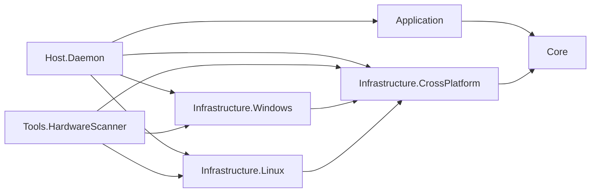

# RigForge — архитектура

Лёгкий кроссплатформенный (Windows 11 + Linux) демон и веб-конфигуратор, заменяющий SignalRGB / NZXT CAM / FanControl:

- **RGB** — единый пространственный 2D-холст: эффект рисуется один раз в управляемый буфер (`CanvasBuffer`, чистый C# `Span<uint>`/SIMD без `SkiaSharp`), каждый диод берёт цвет через предрасчитанную целочисленную таблицу билинейных весов (`PrecomputedTap`);
- **охлаждение** — кривые температура → скважность с гистерезисом, ramp up/down и failsafe;
- **экран СЖО** — виджеты телеметрии 240×240 (масштабируется до 320/640) в реальном времени (`SkiaSharp` инициализируется лениво только при наличии экрана или открытом превью).

Всё оборудование управляется **из user-mode** (USB HID, WinUSB/libusb, NVML). Драйверы ядра не используются; единственное
опциональное исключение — LibreHardwareMonitor с подписанным драйвером **PawnIO** (не WinRing0) для температуры CPU и Super I/O на Windows.

## Структура решения

```text
src/
  Core/                          доменные модели и порты, 0 зависимостей
  Application/                   движки: эффекты (60 FPS), охлаждение (1 Гц), LCD, телеметрия, профиль, валидация
  Infrastructure.CrossPlatform/  HID-транспорт, NZXT Kraken/HUE 2, ASUS Aura USB, NVML, libusb, JSON-хранилище
  Infrastructure.Windows/        DXGI Desktop Duplication, LibreHardwareMonitor (PawnIO), WinUSB, high-res таймер, Win32-сенсоры
  Infrastructure.Linux/          sysfs hwmon (сенсоры + PWM), /proc, заглушка захвата (PipeWire), генератор udev-правил
  Host.Daemon/                   ASP.NET Core (Kestrel) + SignalR + REST/OpenAPI + BackgroundService-воркеры
  Tools.HardwareScanner/         CLI rigforge-scan: дамп HID, dry-run проба, сенсоры, udev, конфликты
tests/RigForge.UnitTests/        xUnit v3 (Microsoft.Testing.Platform)
ui/                              React 19 + TypeScript + Vite + Tailwind 4 + SignalR + react-konva
deploy/                          задача Windows «при входе», systemd user unit, udev-правила
docs/                            Postman-коллекция
```



Платформенные модули подключаются в рантайме (`OperatingSystem.IsWindows()/IsLinux()`), поэтому одна сборка работает на обеих ОС;
Windows-классы помечены `[SupportedOSPlatform("windows")]`, и анализатор CA1416 следит за проверками.

### Порты Core

| Интерфейс | Назначение | Реализации |
| --- | --- | --- |
| `IRgbDevice` | зоны с нормализованными координатами LED, приём кадра | NZXT HUE 2, ASUS Aura USB, Kingston FURY DDR5 (SMBus) |
| `IFanController` | каналы вентиляторов/помпы, `SetDuty`, `RestoreDefault` | Kraken, HUE 2, LHM Super I/O, sysfs hwmon |
| `ISensorProvider` | телеметрия с семантическими ролями (`role:CpuTemperature`…) | Kraken, NVML, LHM, Win32, hwmon, /proc |
| `IAioLcdDevice` | экран СЖО: кадр RGBA, яркость, возврат на экран прошивки | Kraken Z3/2023/2024 |
| `IScreenCapturer` | маленький BGRA-кадр рабочего стола для Ambilight | DXGI (Windows), заглушка (Linux) |
| `IDeviceProbe` | обнаружение и инициализация семейства устройств | по одному на семейство |
| `IProfileStore`, `IPrecisionTimer` | хранение профиля, точный сон рендер-цикла | JSON, waitable timer / `Thread.Sleep` |

Одно физическое устройство реализует несколько интерфейсов поверх одного соединения (Kraken = вентиляторы + сенсоры + LCD).
Списки в `DeviceManager` фильтруются по флагам `Capabilities`, а не только по интерфейсу (например, Kraken, чей LCD занят другой программой).

## Потоки выполнения


- **Телеметрия** опрашивает провайдеров параллельно с таймаутом и защитой от повторного входа (`SemaphoreSlim(1, 1)` на провайдер); показание живёт до 15 с, свежесть проверяют потребители. Для температурных ролей (`CpuTemperature`, `GpuTemperature`, `LiquidTemperature`) выбирается максимальное валидное значение (`Max`), исключая выбор холодного iGPU вместо нагруженной дискретной видеокарты.
- **Эффекты** рендерятся на отдельном потоке (`AboveNormal`) в чистый C# буфер (`CanvasBuffer` без загрузки `libSkiaSharp`) с паузой через `IPrecisionTimer`: на Windows стандартный таймер 15,6 мс
  ограничил бы цикл ~32 FPS, поэтому используется `CREATE_WAITABLE_TIMER_HIGH_RESOLUTION` без глобального `timeBeginPeriod`.
  Кадр каждого устройства уходит через собственный диспетчер: медленный контроллер пропускает кадры, а не тормозит цикл;
  одинаковые кадры не отправляются (кроме keep-alive раз в 2 с). Статические эффекты рендерятся **один раз** и усыпляют поток до смены профиля/раскладки (`0%` CPU в простое), а температурные эффекты просыпаются только по событию `TelemetryService.Updated` (1 Гц).
- **Превью** (LED 20 FPS, LCD-PNG) считаются и отправляются только пока UI-клиент на них подписан (`SetPreview`); при отсутствии экранов и подписчиков `LcdRenderEngine` выгружает `SkiaSharp`-рендереры и спит на сигнале.
- Каждый цикл хостится `ResilientWorker`: исключение перезапускает именно этот цикл через 2 с — ошибка в LCD не остановит вентиляторы.
- Порядок hosted-сервисов: `HardwareLifecycleService` стартует первым (профиль → поиск устройств) и останавливается последним,
  уже после того как циклы вернули железо прошивке.

## Пространственный холст

- Холст — `VirtualCanvas` в абстрактных пикселях (по умолчанию 320×180); эффект рисуется ровно в этом разрешении.
- Каждая зона имеет `ZonePlacement` (x, y, width, height, rotation, enabled, ledCount). (x, y) — левый верхний угол
  неповёрнутого прямоугольника, поворот по часовой стрелке вокруг этого угла — та же семантика, что у узлов Konva в UI.
- Нормализованная позиция LED (0…1) → `X + lx·cos θ − ly·sin θ`, `Y + lx·sin θ + ly·cos θ`; цвет берётся билинейной выборкой.
- Несколько размещений с одним `(deviceId, zoneId)` и разными `segmentId` — части одной ARGB-цепочки: каждый сегмент стоит на холсте отдельно (`Linear`, `Ring` или `Matrix2D`), а в канал уходит их склейка в порядке `placements`. `DeviceColorCorrection` (гамма и баланс белого) применяется таблицей 3×256 после семплинга.
- Неразмещённые зоны автоматически раскладываются сеткой (`CanvasLayoutService`), UI получает «эффективный» холст.
- ARGB-разъёмы ASUS не сообщают длину ленты: число LED задаётся в редакторе (`ledCount`) и применяется через `TryResizeZone`.

## Охлаждение и безопасность

Регулятор канала: EMA-сглаживание → кривая → асимметричный гистерезис (рост применяется сразу, снижение — только после падения
на `HysteresisCelsius` ниже температуры, давшей текущую цель) → ограничение скорости изменения (%/с) → лимиты кривой.

| Защита | Поведение |
| --- | --- |
| Нет свежей температуры (> 5 с) | канал сразу в failsafe 100 % (без ramp) |
| Жидкость ≥ 60 °C | все управляемые каналы 100 % |
| Помпа | никогда ниже `max(минимум прошивки 20 %, MinimumPumpDutyPercent 30 %)` |
| Демон упал, держа низкие обороты Kraken | профиль в прошивке содержит «пол безопасности»: 70 % при 50 °C, 100 % от 55 °C |
| Остановка демона / удаление кривой | Kraken получает кривую по жидкости, HUE 2 — фикс. 60 %, Super I/O — `SetDefault()` (BIOS), hwmon — исходный `pwmN_enable` |
| LHM без прав/PawnIO отдаёт 0 °C | значение отбрасывается (иначе «холодный» CPU занизил бы обороты) → failsafe |

## Протоколы устройств

Байтовые форматы сверены с исходниками liquidctl (`kraken3.py`, `smart_device.py`) и OpenRGB (`AsusAuraUSBController`, `NZXTHue2Controller`).
Пакеты собираются чистыми функциями (`NzxtProtocol`, `AuraUsbProtocol`, `KrakenLcdUploader`), покрытыми тестами.

**NZXT (VID 0x1E71)** — 64-байтные HID-отчёты, report ID = байт команды, ответ = команда + 1.

- Kraken Z3/2023/2024: статус `74 01` → `75 …` (жидкость `[15] + [16]/10`, помпа RPM/duty `[17..19]`, вентиляторы `[23..25]`);
  скважность — профиль из 40 значений для 20…59 °C: `72 <канал 3 байта> <40 duty>`.
- Экран Kraken: HID-команды + bulk-endpoint `0x02` с заголовком `12 FA 01 E8 AB CD EF 98 76 54 32 10 <mode> 00 00 00 <len LE32>`.
  Kraken 2023 с прошивкой 2.x — прямая запись RGB565 big-endian (`36 01 00 01 06` … `36 02`), остальные — RGBX в один из 16 «бакетов»
  (RAM контроллера, износа нет) с переключением `38 01 04 <idx>`.
- HUE 2 (RGB Controller, Control Hub, RGB & Fan Controller, Smart Device V2): прямой режим `22 1g <1<<ch> 00 GRB×20` + `22 A0 …`,
  до 40 LED на канал; аксессуары из `21 03`; вентиляторы `62 01 <mask> <duty…>`, статус `67 02`.
- Windows: bulk-интерфейс Kraken привязан к WinUSB — используется нативный WinUSB API (как у liquidctl), без libusb DLL.
  Linux: libusb-1.0 через LibUsbDotNet.

**ASUS Aura USB (VID 0x0B05)** — 65-байтные отчёты с report ID `0xEC`, только HID-коллекция usage page `0xFF72`.
Конфиг-таблица `B0` (`[0x02]` — число ARGB-разъёмов, `[0x1B]` — LED платы), режим Direct `35 <effect ch> 00 00 FF`,
кадр `40 <direct ch | 0x80 apply | 0x10 overflow> <offset> <count> RGB×20`; канал платы — `0x04`. Прошивки `AULA3-AR32*`
нумеруют effect-каналы ARGB с нуля. Команда сохранения в flash (`3F 55`) никогда не отправляется.

**Kingston FURY DDR5 DRAM RGB (SMBus `0x60..0x63`)** — по 12 диодов на планку (`KingstonFuryDramProtocol`, по `KingstonFuryDRAMController` из OpenRGB):
- **Шина:** на Windows — подписанные модули `SmbusPIIX4.bin` (порты 0/1 AMD FCH) и `SmbusI801.bin` через `\\?\GLOBALROOT\Device\PawnIO` с глобальным мьютексом `Access_SMBUS.HTP.Method`; на Linux — `/dev/i2c-*` (`i2c-piix4` / `i2c-i801`).
- **Шесть барьеров безопасности (`SmbusSafetyGuard`):**
  1. до открытия SMBus проверяется SMBIOS Type 17 (`KF5*` part number, 0 байт на шине, если планок нет);
  2. жёсткий файрвол адресов разрешает только `0x60..0x63` (обращения к SPD5118 `0x50..0x57` и PMIC `0x48..0x4F` блокируются исключением до `DeviceIoControl`/`ioctl`);
  3. белый список регистров: чтение `0x01..0x04` (сигнатура `"FURY"` в старшем байте слова) и `0x06` (`0x10` Beast, `0x11` Renegade, `0x12` Beast White, `0x15` Beast2); запись только в SRAM контроллера (`0x08` = `0x53`/`0x44`, `0x09` = `0x10` Direct, `0x0B` = `0x00`, `0x20` яркость, `0x27` число слотов, `0x50..0x73` RGB);
  4. межпроцессный мьютекс `Access_SMBUS.HTP.Method`;
  5. пауза `3 мс` через `IPrecisionTimer` (`CREATE_WAITABLE_TIMER_HIGH_RESOLUTION`) только на границах транзакции (`0x08 = 0x53` / `0x44`), без задержки между регистрами `0x50..0x73` (по `Kingston Hyper Fury Ram.js` из SignalRGB — до 30 FPS плавного потока) + дифф-кэш регистров на каждый слот (неизменившиеся байты и повторные статичные кадры дают **0 транзакций SMBus**);
  6. read-only диагностика `rigforge-scan smbus` проверяет SMBIOS, PawnIO и сигнатуру `"FURY"` без смены режима подсветки.

## UI (ui/)

React 19 + TypeScript 6 (strict, `noUncheckedIndexedAccess`) + Vite 8 + Tailwind 4 + `@microsoft/signalr` + react-konva + zod.
TypeScript закреплён на 6.0: typescript-eslint пока не поддерживает 7.x.

- `api/` — контракт (`contracts.ts`, зеркало `Dtos.cs`), типизированный `DaemonClient` (бесконечный реконнект, повторная подписка
  на превью после переподключения), zod-схемы (лимиты не мягче серверных валидаторов).
- `state/` — Context + `useReducer` для состояния, телеметрии и статуса вентиляторов; поток LED-превью 20 FPS хранится вне reducer
  (`ledPreviewStore` + `useLedPreview`), поэтому перерисовывается только слой диодов.
- `features/` — Dashboard, Lighting (редактор холста на Konva: перетаскивание, resize, поворот с шагом 15°, длина ARGB-лент),
  Cooling (SVG-редактор кривой с живым маркером, пресеты для помпы и вентиляторов), LCD (живое превью), Devices.
- Ошибки — `ErrorBoundary` на каждую страницу и тосты с текстом `HubException`. Страница Lighting (Konva) грузится лениво.

Dev: Vite на :5173 проксирует `/hubs` (WebSocket) и `/api` на демон. Prod: `npm run build` пишет в `src/Host.Daemon/wwwroot`,
демон отдаёт UI сам (`/` + SPA-fallback), OpenAPI в Production скрыт.

## Ключевые решения

| Решение | Почему |
| --- | --- |
| .NET 10 (LTS) вместо 8/9 | на машине установлен только .NET 10; поддержка .NET 8 и 9 заканчивается 10.11.2026. TFM задан в `Directory.Build.props` |
| Демон как задача «при входе», не служба | DXGI Desktop Duplication не работает из session 0; повышенные права нужны LHM/PawnIO. `AddWindowsService()` оставлен для headless-режима без Ambilight |
| Ручной маппинг DTO вместо AutoMapper, без MediatR | процесс-демон с одним хабом; обе библиотеки стали коммерческими; ручные проекции дешевле и совместимы с trimming/AOT |
| FluentValidation + ProblemDetails | единая валидация профиля для SignalR (`HubException`) и REST (`ValidationProblem`) |
| Документы профиля без отдельных DTO | `RigProfile` и его части — неизменяемые записи настроек: тот же формат на диске и в API, валидируются целиком |
| Проверка `Origin` + host filtering | WebSocket не защищён CORS: без этого любая веб-страница могла бы через 127.0.0.1 менять кривые вентиляторов (localhost CSRF), а DNS-rebinding — обойти проверку хоста |
| `Hardware:DryRun` | обнаружение и сенсоры без записи в RGB/вентиляторы/LCD — для первого запуска рядом с vendor-софтом и диагностики |
| `nuget.config` только с nuget.org | на машине есть корпоративные фиды; source mapping исключает dependency confusion |

## Память и размер (замеры на этой машине, dry-run, 20 с после старта)

| Конфигурация | Private, МБ | Working Set, МБ |
| --- | ---: | ---: |
| Ядро (ASP.NET Core + SignalR + SkiaSharp + движки), без железа | 20,1 | 64,5 |
| + NZXT, ASUS, LibreHardwareMonitor | ≈ 23 | ≈ 79 |
| + NVML (всё включено) | 43–46 | ≈ 102 |

Цель 20–30 МБ выполняется для ядра и USB-устройств; **NVML добавляет ≈ 20 МБ** нативной памяти драйвера (`Hardware:Nvidia:Enabled=false`
отключает). Управляемая куча — 5–8 МБ. Working Set включает разделяемые страницы DLL (CoreLib, SkiaSharp, nvml.dll).
Workstation GC без фонового потока; `DOTNET_GCgen0MaxBudget=0x400000` экономит ещё ~3 МБ (на Linux задано в unit-файле;
ключ в runtimeconfig рантайм не принимает). Release ведёт себя так же (≈ 49 МБ private со всем железом).
CPU: 2,6 % одного ядра при 60 FPS эффекта на 7 зонах. Framework-dependent publish для win-x64 — 22 МБ
(нативные PDB из пакетов, в т.ч. 92 МБ `libSkiaSharp.pdb`, исключаются).

## Запуск

```powershell
# демон (dev): Kestrel на http://127.0.0.1:5757, dry-run профиль есть в launchSettings
dotnet run --project src/Host.Daemon
# UI (dev): http://localhost:5173, /hubs и /api проксируются на демон
cd ui; npm install; npm run dev
# диагностика (dry-run, ничего не пишет в RGB/вентиляторы/LCD)
dotnet run --project src/Tools.HardwareScanner -- hid
dotnet run --project src/Tools.HardwareScanner -- smbus
dotnet run --project src/Tools.HardwareScanner -- sensors --watch
# тесты
dotnet test --project tests/RigForge.UnitTests
# Windows: сборка UI + publish + задача при входе (от администратора)
.\deploy\windows\Install-RigForgeTask.ps1
```

Linux: `rigforge-scan udev -o 60-rigforge.rules` → `/etc/udev/rules.d/`, затем `deploy/linux/rigforge.service` как user unit.
Перед запуском закройте NZXT CAM, SignalRGB и LightingService (Armoury Crate) — демон предупреждает о них в UI и логе.

## Состояние и ограничения MVP

Проверено на целевом ПК (read-only/dry-run): обнаружены Kraken 2023 (`1E71:300E`, прошивка 2.0.0), NZXT RGB Controller (`1E71:2012`,
2× F140 RGB), NZXT Control Hub (`1E71:2022`, 5 вентиляторных каналов, F120 RGB), ASUS Aura (`0B05:19AF`, `AULA3-AR32-0309`, 3 ARGB),
Kingston FURY DDR5 RGB (`kingston-fury-ddr5:piix4-0:1-3`, шина `PIIX4 port 0` `0x0B00`, слоты `0x61` и `0x63`, модель `0x10`, `KF556C40-32`, 2×12 LED),
Super I/O `Nuvoton NCT6701D` на `ASUS ROG STRIX B850-E GAMING WIFI` (7 каналов) и `AMD Ryzen 7 9800X3D` через PawnIO `2.2.0.0`,
RTX 5070 Ti через NVML; статус Kraken и Control Hub разобран корректно. UI проверен в браузере против реального демона:
живые сенсоры, раскладка реальных зон с потоковым LED-превью, кривая помпы (28,4 °C → 47 %), живое превью LCD.

Живой тест (без dry-run, вентиляторы не трогались): плавный rainbow-wave на Aura (плата + ARGB), на NZXT RGB Controller и Control Hub
(контроллер подтверждает кадры отчётами `FF 01 … 22 10 / 22 A0`), на планках ОЗУ Kingston FURY DDR5 RGB (`0x61` и `0x63` по SMBus через PawnIO, до 30 FPS без рывков)
и дашборд на экране Kraken 2023 (FW 2.x, поток RGB565 через WinUSB) подтверждены визуально; ошибок в логе нет.

Не проверено на железе: установка скважности помпы и вентиляторов (намеренно не трогались). Скважность для портов 4–5
Control Hub — экстраполяция формата `62 01` на 5 каналов.

Не реализовано: захват экрана на Linux (xdg-desktop-portal + PipeWire), Kraken X3 (`0x2007/0x2014`), подсветка кольца Kraken Elite,
управление вентиляторами GPU, Native AOT, восстановление яркости LCD, бывшей до запуска (сейчас выставляется из профиля, 80 %).

## Дорожная карта развития (Public Distribution & Custom Effects)

Спецификации и планы этапов зафиксированы в `docs/superpowers/specs/`:
1. **Этап 1 (Реализовано):** перевод RGB-рендерера на чистый C# (`CanvasBuffer` + `PrecomputedTap`) без `SkiaSharp`, Event-Driven сон фоновых воркеров, разделение локов чтения/записи HID, пулинг `LibUsb` (0 аллокаций в LOH), батч-мьютекс SMBus, разрешение температурных ролей по `Max` и посекционное восстановление повреждённого `profile.json`.
2. **Этап 2 (Реализовано):** декларативный каталог `IDeviceManifestCatalog` (`JsonDeviceManifestCatalog` + внешние JSON-манифесты в `%LOCALAPPDATA%\RigForge\devices\*.json`), неразрушающий Delta-рескан `DeviceManager` с подпиской на USB hotplug, универсальный `SmbusAddressFirewall`, прямой парсер `SmbiosType17Parser` (`GetSystemFirmwareTable('RSMB')` без `new SMBios()`) и отключение 24-часовых буферов истории `LibreHardwareMonitor` (~47–52 МБ Private Working Set со всеми 9 устройствами).
3. **Этап 3 (Цель — `2026-11-01-custom-effects-and-zero-alloc-rgb-design.md`):**
   - **Кастомные и маркетплейс-эффекты (цель):** полный холст для игр (*Pong*, *Mario*), WebGL-превью в UI и аудиоспектр (*Audio Visualizer*). Песочница прямого семплинга уже есть, см. следующий пункт.
   - **WASM-песочница прямого семплинга (Реализовано):** `{DataDirectory}/effects/*.wat|*.wasm` рядом с одноимённым `.json`. Wasmtime без WASI и без импортов, память 32-бит с максимумом не больше 32 страниц (2 МиБ), топливо на старт модуля и на каждый `sample`. Гость пишет `0x00RRGGBB` только в точки реальных диодов; `Engine` не создаётся, если каталог пуст. Совпадение `id` со встроенным эффектом пропускается. Пример: `effects/wasm-plasma`.
   - **Direct LED Sampling и схема параметров (Реализовано):** двухрежимный `IEffect.TrySamplePoints` — процедурные эффекты считают цвет только в координатах реальных диодов (`LedPoint` предвычисляются в `LedSamplePlan`, 0 аллокаций на кадр), холст растеризуется только для эффектов, отказавшихся от семплинга (`Ambilight`). Параметры эффектов описываются декларативной схемой `EffectParameterDefinition` (`ColorList` / `FloatRange` / `SensorSelector`), значения хранятся в словаре `EffectSettings.Parameters` (JSON), UI-форма и валидатор строятся по схеме; `profile.json` мигрирует со `schemaVersion` 1 на 2 (старые плоские поля сворачиваются в `Parameters` конвертером).
   - **Zero-Allocation протоколы (Реализовано):** `AuraUsbProtocol.WriteDirectPacket`, `NzxtProtocol.WriteHue2Packet` и `KingstonFuryDramProtocol.BuildFrameWrites` пишут пакеты и SMBus-команды напрямую в буфер вызывающего (`Span<byte>` / предвыделенный `KingstonRegisterWrite[]`), 0 аллокаций на кадр после прогрева для удержания управляемой кучи C# на уровне ~7–8 МБ при многочасовой работе.
   - **Сегментирование ARGB-цепочек, Matrix2D и цветокоррекция (Реализовано):** один физический ARGB-порт раскладывается на независимые `ZonePlacement` (`segmentId`, своё положение и топология) в порядке цепочки; `LedTopology.Matrix2D` строит построчную сетку, `Serpentine` разворачивает нечётные ряды. Сумма `ledCount` сегментов меняет размер зоны. На устройство задаётся `DeviceColorCorrection` (гамма 0.5..3 и баланс белого `#RRGGBB`): `LedSamplePlan` заранее считает три таблицы по 256 байт и применяет их при прямом семплинге и при чтении холста без аллокаций на кадр.
4. **Этап 4 (Цель):** универсальный движок кастомных дисплеев (`IDisplayDevice` с поддержкой произвольных пропорций, мульти-экранного профиля `Displays[deviceId]` и нативных форматов `Rgb565`, `Jpeg`, `Rgba8888`).
